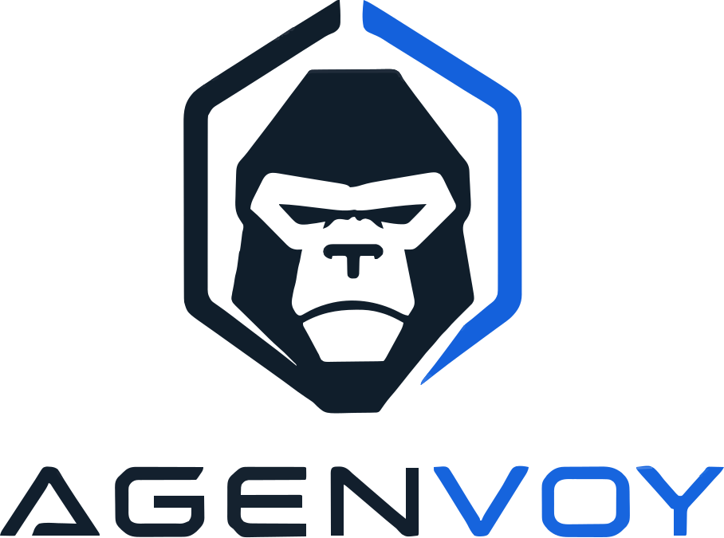

<p align="center">
  <picture style="margin-down: 1rem">
    
  </picture>
</p>

<p align="center">
  <strong>Make AI do the work on your computer—not just talk about it</strong>
</p>

<p align="center">
  Agenvoy is an open-source, self-hosted 24/7 personal AI agent that runs on your own computer — your memory, schedules, tools and credentials stay local.<br>
  From live research and file work to automation, it takes action and delivers results in a single Go binary; through MCP, it shares sandboxed tools with Claude Code, Codex, and other agents.
</p>

<p align="center">
<a href="https://trendshift.io/repositories/41899?utm_source=trendshift-badge&amp;utm_medium=badge&amp;utm_campaign=badge-trendshift-41899" target="_blank" rel="noopener noreferrer">

</a>
</p>

<p align="center">
  <a href="https://github.com/pardnchiu/agenvoy/releases"></a>
  <a href="LICENSE"></a>
</p>

<p align="center">
  <strong>English</strong> · <a href="./doc/README.zh.md">繁體中文</a>
</p>

> [!NOTE]
> Agenvoy is currently in a review-and-cleanup period. File-by-file progress: [Optimization Progress](./doc/optimization.md).

## Taiwan-developed AI Agent Harness

Agenvoy is a Taiwan-developed AI Agent Harness by [Pardn Chiu](https://pardn.io/), built to turn conversation into completed work on your computer. It coordinates models, context, tools, real-time data, task routing, memory, schedules, and execution in one workflow, while keeping control of your files and environment in your hands. Through the Web interface, it also supports hands-free voice interaction with natural speech, wake-word detection, and interruptible spoken replies; the full result remains available in the chat.

## Why Agenvoy

A chat can give you an answer; work needs a result. Agenvoy breaks requests into steps, calls tools, and delivers outcomes on your computer—while you retain control of files, tools, schedules, and working context.

- **Turns conversation into deliverable work** — Research live data, organize files, and complete multi-step tasks with an agent that acts and reports the result.
- **Fills capability gaps itself** — Finds a keyless public API and calls it directly; when none fits, creates, tests, and keeps a new tool, ready to reuse next time.
- **Shares one tool library across agents** — Agenvoy, Claude Code, Codex, and other agents use the same sandboxed tools instead of rebuilding them.
- **Keeps automation running** — Create schedules in one sentence; recurring work runs in your environment and pushes the result.
- **Makes every step visible and controllable** — Command output streams to the TUI and Web dashboard, while sensitive paths and restricted actions still require confirmation.
- **Connects models and external services freely** — Route models by task and configure image generation, STT, TTS, stdio/HTTP MCP servers, and OAuth.
- **Provides private access from anywhere** — The local daemon connects outward to Telegram and Discord, without making your host public or opening inbound ports.

## Validated designs

Agenvoy has already implemented the design directions below, and other teams have since adopted similar approaches, confirming that these directions solve real problems agents face in practice. Every milestone links to a public commit or release, so you can check it yourself.

| Shipped in Agenvoy                                                                                                                                                                                                                                                                                                                                                                                                            | Design                                     | Same direction elsewhere                                                                                                                                                                                                                                                                                                                                                                                                                                                                                                                                                                                                                                                                                                                                              |
| :---------------------------------------------------------------------------------------------------------------------------------------------------------------------------------------------------------------------------------------------------------------------------------------------------------------------------------------------------------------------------------------------------------------------------- | :----------------------------------------- | :--------------------------------------------------------------------------------------------------------------------------------------------------------------------------------------------------------------------------------------------------------------------------------------------------------------------------------------------------------------------------------------------------------------------------------------------------------------------------------------------------------------------------------------------------------------------------------------------------------------------------------------------------------------------------------------------------------------------------------------------------------- |
| 2025-06-28 [Implement core application](https://github.com/agenvoy/cim-prototype/commit/df4fa95a01)<br>2025-06-29 [add traditional memory structure](https://github.com/agenvoy/cim-prototype/commit/d9a109c270)                                                                                                                                                                                                              | Summary-based memory for unbounded context | 2025-11-24 [Claude client-side compaction](https://platform.claude.com/docs/en/release-notes/overview#november-24-2025)                                                                                                                                                                                                                                                                                                                                                                                                                                                                                                                                                                                                                                    |
| 2026-01-04 [bubblewrap sandbox](https://github.com/pardnchiu/HakoRun/commit/87af1ba486)<br>2026-02-01 [harden bubblewrap sandbox](https://github.com/pardnchiu/HakoRun/commit/0cae0ed8c5)<br>2026-03-07 [block sensitive paths and credentials](https://github.com/agenvoy/Agenvoy/commit/fdaaa62b3b)<br>2026-03-18 [sandbox execution with bubblewrap](https://github.com/agenvoy/Agenvoy/commit/1f458d3596)                 | Sandbox mode for secure agents             | 2026-03-16 [NVIDIA NemoClaw](https://blogs.nvidia.com.tw/blog/nvidia-announces-nemoclaw) |
| 2026-02-07 [Copilot device code login](https://github.com/agenvoy/Agenvoy/commit/3d4020dfb2)<br>2026-04-04 [OpenAI Codex (OAuth) provider](https://github.com/agenvoy/Agenvoy/commit/748b551ce1) | Sign in with an existing AI subscription | 2026-09-29 [Pi 0.99.0 Sign in with ChatGPT](https://github.com/earendil-works/pi/blob/v0.99.0/packages/coding-agent/docs/providers.md#authenticate-interactively) |
| 2026-02-27 [LLM-driven agent routing](https://github.com/agenvoy/Agenvoy/commit/0514cc1127)<br>2026-03-10 [configurable dispatcher model selection](https://github.com/agenvoy/Agenvoy/commit/e4274818e7)<br>2026-04-15 [strengthen agent tier routing](https://github.com/agenvoy/Agenvoy/commit/055af67e44)<br>2026-06-10 [tiered routing across providers](https://github.com/agenvoy/Agenvoy/commit/d3c5d9f63a)<br>2026-09-11 [configurable model tiers for agent and subagent routing](https://github.com/agenvoy/Agenvoy/commit/2032737d23)<br>2026-09-11 [model tier controls on fallback priority](https://github.com/agenvoy/Agenvoy/commit/b393d22f12) | Route each task to the model best suited to it | 2026-09-14 [Copilot auto model selection tiers: efficiency / balance / intelligence](https://github.blog/changelog/2026-09-14-configure-cost-and-quality-in-copilot-auto-model-selection/)<br>2026-09-29 [Pi 0.99.0 virtual models: per-request model and thinking level](https://github.com/earendil-works/pi/blob/v0.99.0/packages/coding-agent/docs/virtual-models.md)<br>2026-09-29 [Pi 0.99.0 classifier models](https://github.com/earendil-works/pi/blob/v0.99.0/packages/coding-agent/docs/llama-cpp.md#classification) |
| 2026-03-23 [script tool support with sandboxed execution](https://github.com/agenvoy/Agenvoy/commit/eb789ef4be)<br>2026-05-14 [script tool scaffolding skill](https://github.com/agenvoy/Agenvoy/commit/33a62c9161)<br>2026-06-05 [script tool runtime metadata](https://github.com/agenvoy/Agenvoy/commit/74ac5bf7eb) | Custom JS / Python tools run in the sandbox | 2026-09-29 [Pi 0.99.0 codemode: model-written JavaScript in a QuickJS sandbox](https://github.com/earendil-works/pi/blob/v0.99.0/packages/coding-agent/docs/cli.md#enable-codemode) |
| 2026-04-02 [deferred tool loading with search_tools](https://github.com/agenvoy/Agenvoy/commit/650711b764)<br>2026-05-05 [MCP client adapter with stdio/HTTP transports](https://github.com/agenvoy/Agenvoy/commit/bda9b15a08)<br>2026-06-07 [tool search registry](https://github.com/agenvoy/Agenvoy/commit/679d5544c7)<br>2026-08-08 [MCP OAuth flow](https://github.com/agenvoy/Agenvoy/commit/751e97c541) | Load tools on demand instead of declaring them all | 2026-09-29 [Pi 0.99.0 built-in MCP + tool_search](https://github.com/earendil-works/pi/blob/v0.99.0/packages/coding-agent/docs/mcp.md) |
| 2026-04-17 [invoke_subagent tool](https://github.com/agenvoy/Agenvoy/commit/db690a51d4)<br>2026-04-25 [session action logs](https://github.com/agenvoy/Agenvoy/commit/a78ae4e4c1)<br>2026-04-25 [session log streaming endpoint](https://github.com/agenvoy/Agenvoy/commit/78806be270)<br>2026-04-28 [subagent name dispatch](https://github.com/agenvoy/Agenvoy/commit/fb20bab34a)                                           | Invoke sub-agents and track their logs     | 2026-08-03 [Claude Code cross-session messaging](https://code.claude.com/docs/en/whats-new/2026-w32)                                                                                                                                                                                                                                                                                                                                                                                                                                                                                                                                                                                                                                                       |
| 2026-05-28 [extension tool loading](https://github.com/agenvoy/Agenvoy/commit/d92d37512b)<br>2026-05-28 [extension install and upload skills](https://github.com/agenvoy/Agenvoy/commit/4566ef49ae)<br>2026-05-29 [extension marketplace](https://github.com/agenvoy/Agenvoy/commit/ddc9b02903)<br>2026-06-08 [ext_ extension tools and scaffolding](https://github.com/agenvoy/Agenvoy/commit/2f2ba6e3ae)                    | Everything is a plugin                     | 2026-08-13 [DeepSeek Harness: everything is a plugin](https://www.deepseek.com/harness/en/)                                                                                                                                                                                                                                                                                                                                                                                                                                                                                                                                                                                                                                                                |
| 2026-06-03 [ask_user interruption async resume](https://github.com/agenvoy/Agenvoy/commit/137b322243)<br>2026-06-04 [preserve in-progress action memory across interruptions](https://github.com/agenvoy/Agenvoy/commit/a6b5e98f39)<br>2026-06-29 [pending task resume](https://github.com/agenvoy/Agenvoy/commit/757493e53b)<br>2026-07-03 [write_todo checklist flow](https://github.com/agenvoy/Agenvoy/commit/3b7c69cd05) | Resume long tasks from a checkpoint        | 2026-08-04 [pi harness v2 in-memory storage](https://github.com/earendil-works/pi/commit/1d0c974713)<br> 2026-08-05 [pi indexed harness recovery queries](https://github.com/earendil-works/pi/commit/591f22a618)<br>2026-08-05 [pi validate harness recovery record logs](https://github.com/earendil-works/pi/commit/a5953d2e15)<br>2026-08-05 [pi harness v2 jsonl backend](https://github.com/earendil-works/pi/commit/651d5d6a53)<br>2026-08-06 [pi atomic writes + torn-tail truncation](https://github.com/earendil-works/pi/commit/a838c069e6)<br>2026-08-14 [pi AgentHarness R3 generation recovery](https://github.com/earendil-works/pi/commit/a606448360)<br>2026-08-14 [pi AgentHarness R4 tool execution](https://github.com/earendil-works/pi/commit/d411d7b05e) |

## What you can do with it

<details>
<summary><strong>Ask live questions and get live answers (Web Search / Tool Generate)</strong></summary>

> What's the weather in Taipei?
>
> The agent finds current data, calls tools, and gives you the answer.
>
> If a tool doesn't exist, it calls a public API or builds one.

<p align="center">
  <a href="https://youtu.be/floMBsAfziY">
    
  </a>
</p>

</details>

<details>
<summary><strong>Turn one sentence into automation (Scheduler)</strong></summary>

> Report TSMC stock price every morning at 8am
>
> The agent asks:
>
> - Where to push results
> - What format you want
> - When to run
>
> Then creates the schedule automatically.

<p align="center">
  <a href="https://youtu.be/5To3joKlFpU">
    
  </a>
</p>

</details>

<details>
<summary><strong>Ask questions about your local files (File Search / RAG)</strong></summary>

> Find all invoices from last year
>
> Which document mentions Prompt guide?
>
> The agent searches your local files and answers directly.

<p align="center">
  <a href="https://youtu.be/vqoQ6Qvl8qU">
    
  </a>
</p>

</details>

<details>
<summary><strong>Finish multi-step work (Skills / Sub-agents)</strong></summary>

> Summarize today's GitHub commits and generate a progress report
>
> The agent breaks down the task, calls tools, combines results, and replies.

<p align="center">
  <a href="https://youtu.be/nIV1xz_HIJg">
    
  </a>
</p>

</details>

<details>
<summary><strong>Work with the agents you already use (MCP Server)</strong></summary>

> Agenvoy is also an MCP server.
>
> Claude Code, Codex, OpenCode, and other AI agents can connect and:
>
> - Use all your sandboxed tools
> - Auto-build new tools when none exist
> - Share every tool across all agents
>
> One line of config. Instant shared tool library.
> Tools created in the demo: [`fetch_weather`](doc/demo/fetch_weather/) · [`fetch_crypto_price`](doc/demo/fetch_crypto_price/)

<table>
<tr>
<td width="33%" valign="top">

#### Claude Code creates a weather tool (1)

</td>
<td width="33%" valign="top">

#### Codex reuses it and creates a crypto tool (2)

</td>
<td width="33%" valign="top">

#### Agenvoy tests both tools (3)

</td>
</tr>
<tr>
<td>

[](https://youtu.be/on5IaoxBO1E)

</td>
<td>

[](https://youtu.be/2DDFCIcbnso)

</td>
<td>

[](https://youtu.be/KPs4o9xDFjM)

</td>
</tr>
</table>

</details>

## Who it's for

If you want AI to complete work—not merely respond—within an environment you control, Agenvoy is for you:

- People who want to turn research, file work, and recurring reporting into reusable automation
- Developers who want a self-hosted agent with local data control and sandbox guardrails
- Teams that want Claude Code, Codex, and other agents to share tools instead of rebuilding them
- Technical operators who need private access to a local agent through the Web, Telegram, or Discord

---

## Drive Your Agent From the Browser

Manage sessions, tools, schedules, and memory from a browser. The dashboard ships inside the binary — start the daemon and open http://127.0.0.1:17989. It is served by your own machine, so nothing leaves your device.

See the [Web UI comparison (old / new, light / dark)](doc/diff/README.md) for the v1.3.4 interface refresh.

<p align="center">
  <a href="https://youtu.be/oaXxrTNvLaU">
    
  </a>
</p>

---

## Chatbot Integrations

Agenvoy currently supports **Telegram and Discord** as chatbot channels. The local daemon initiates outbound connections to these platforms, so you only need to configure a bot token—without exposing inbound ports, setting up a reverse proxy, or making your host public. While a task is running, new messages steer it; start a separate task with `/new <message>` (listed in Telegram's command menu).

Since **v0.34.4**, Telegram and Discord have paused the default flow that automatically replies to voice input with voice output. You can still use STT/TTS tools to generate audio and send the resulting audio files to either channel.

---

## One-line install

<details open>
<summary><strong>macOS / Linux distributions</strong></summary>

Run this in a terminal:

```bash
curl -fsSL https://agenvoy.com/scripts/install.sh | bash
```

> **macOS tip:** If you run schedules on a MacBook, also run:
>
> ```bash
> sudo pmset -c sleep 0
> ```
>
> This prevents sleep from interrupting schedules.

</details>

<details>
<summary><strong>Windows (via WSL)</strong></summary>

First open PowerShell as an administrator, then list and install a Linux distribution:

```powershell
wsl --online --list
wsl --install <distribution-name>
```

After installation, restart your computer, open a WSL terminal, and run:

```bash
curl -fsSL https://agenvoy.com/scripts/install.sh | bash
```

</details>

### Run one prompt from the shell

```bash
agen -p "Summarize today's commits" --stream
```

`agen -p` sends one prompt to the local daemon and prints the reply. It is read-only and sandboxed by default; add `--allow-edit` to let it write and `--skip-sandbox` to let it leave `$HOME`. See the [docs](doc/doc.md#one-shot-prompt) for every flag.

## Developer Recommendations

A cost-effective model setup to get started:

1. Choose a subscription model for everyday primary use, such as:
   - GitHub Copilot ($10/mo) — pick `gpt-5.6-luna`: its quota drains slowly enough for daily use and it is capable enough for most work
   - OpenAI ChatGPT Plus ($20/mo)
   - SuperGrok ($30/mo)
2. **No free plan is recommended.** Since 2026-11-09 (5:40 PM PT), Ollama Cloud's Free plan is pay-as-you-go: hosted models such as `gemma4:31b`, `gpt-oss:120b`, `gpt-oss:20b`, `nemotron-3-super` and `nemotron-3-ultra` need purchased credits, so Ollama Cloud no longer offers a free way to try Agenvoy. Running models locally with Ollama stays free, but small local models call tools unreliably. The lowest-cost recommendation is GitHub Copilot ($10/mo) above.
3. Add TypeSafe's Jev as the decision model: create a key in the [TypeSafe Console](https://console.typesafe.ai/keys), add it with `/model add` → **API Key** → **TypeSafe**, then pick `typesafe@jev-latest` under `/model` → **decision**. It is billed only on input tokens ($42 per billion, output free, per [TypeSafe's model page](https://docs.typesafe.ai/models) on 2026-11-11) and keeps irrelevant skills, memory entries, search results and page boilerplate out of each turn; on the author's machine it left 95.8% of skill entries out of the turn context. Setup and measurements: [Quickstart](https://agenvoy.com/docs/quickstart).

---

## Core capabilities

| Capability           | Description                                                              |
| :------------------- | :----------------------------------------------------------------------- |
| Auto tool generation | Calls a public API, or builds and saves a tool when none fits            |
| Self-scheduling      | Create cron jobs with a single sentence                                  |
| Long-term memory     | Retains key info and context                                             |
| File search          | Answers from your local files                                            |
| Sub-Agent            | Multi-agent collaboration                                                |
| MCP client           | Connect to external MCP services via official go-sdk (live tool refresh) |
| MCP server           | Expose sandboxed tools to any MCP-compatible agent                       |
| Reasoning guides     | On-demand rules via `reasoning_guide(topics=[...])`                         |
| Tool Market          | Share and install tools                                                  |
| Image generation     | Generate images through a configured provider                            |
| Live command output  | Stream `run_command` progress to the TUI and Web dashboard               |
| Rich chat rendering  | Web chat renders charts, Mermaid diagrams, math, and highlighted code    |
| Secure file boundary | Confirm sensitive paths and out-of-home access before granting them      |
| Explained prompts    | Command confirmations state in one sentence what the call will do        |
| MCP OAuth            | Log in to HTTP MCP servers and persist tokens in the OS keychain         |
| Transcription        | Audio and video to text                                                  |
| Self-improvement     | Auto-fixes after execution failures                                      |

---

## Docs

Full documentation at **[agenvoy.com/docs](https://agenvoy.com/docs/)**

- [Getting Started](https://agenvoy.com/docs/getting-started)
- [Sessions & Agents](https://agenvoy.com/docs/sessions)
- [Providers](https://agenvoy.com/docs/providers)
- [Built-in Tools](https://agenvoy.com/docs/built-in-tools)
- [MCP Server](https://agenvoy.com/docs/mcp-server)
- [MCP Client](https://agenvoy.com/docs/mcp-client)
- [Memory System](https://agenvoy.com/docs/memory-system)
- [Skill System](https://agenvoy.com/docs/skill-basics)
- [Sandbox](https://agenvoy.com/docs/sandbox)
- [Architecture](https://agenvoy.com/docs/architecture)

## License

This project is dual-licensed.

- **Open source** — [GNU Affero General Public License v3.0](LICENSE). You may use, modify and distribute it, provided derivative works and any network-accessible service built on it are released under the same license, source included.
- **Commercial** — for use that cannot meet the AGPL-3.0 source-disclosure requirement, a commercial license is available. It covers rights to the software only; any work on the project requested from the developer is quoted and charged separately. See [COMMERCIAL.md](COMMERCIAL.md).

Under section 7(b) of the AGPL-3.0, the **License** and **Source** entries in the `Other` group of the web interface's `Config > System` tab must be preserved: they carry the copyright notice, the warranty disclaimer, the license statement, and the corresponding-source link that section 13 requires. They may be relocated or restyled while remaining prominently visible, but not removed or hidden. A commercial license removes this requirement.

## Author

Just [open an issue](https://github.com/pardnchiu/agenvoy/issues/new) to share an idea.

<a href="https://github.com/pardnchiu/agenvoy/graphs/contributors">
  
</a>

---

©️ 2026 [邱敬幃 Pardn Chiu](https://www.linkedin.com/in/pardnchiu)
