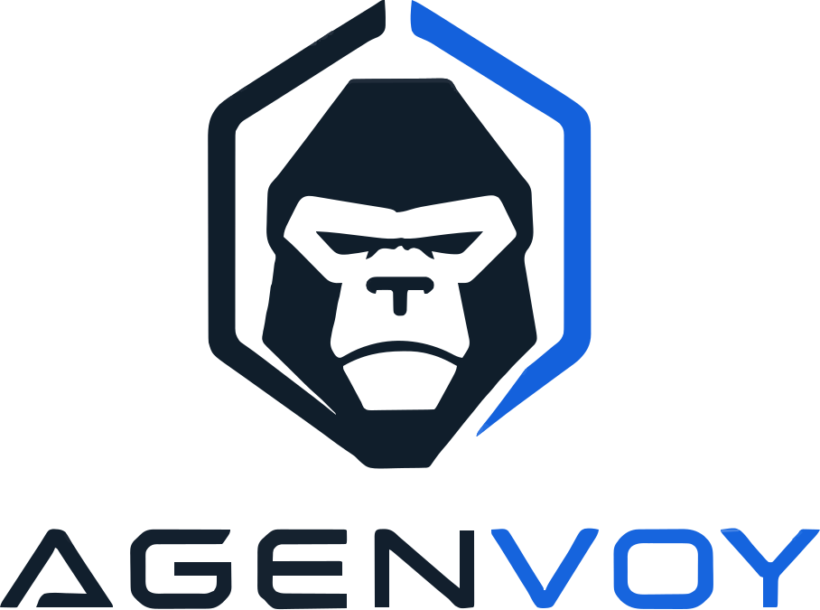
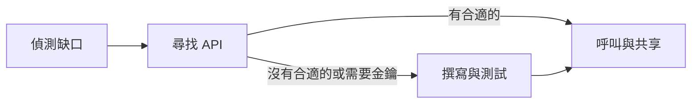

<p align="center">
  <picture style="margin-down: 1rem">
    
  </picture>
</p>

<p align="center">
  <strong>你的私有本地 AI Agent —— 24 小時跑在你自己的電腦上</strong>
</p>

<p align="center">
  不是別人雲端上的虛擬機 —— Agenvoy 以 daemon 常駐在你的電腦，記憶、排程、工具與憑證都留在你自己的硬碟。<br>
  一句話說出需求，它自動打造工具、在沙箱測試，並與 Claude Code、Codex 及任何 MCP agent 共享；這一切都來自單一 Go 執行檔。
</p>

<p align="center">
<a href="https://trendshift.io/repositories/41899?utm_source=trendshift-badge&amp;utm_medium=badge&amp;utm_campaign=badge-trendshift-41899" target="_blank" rel="noopener noreferrer">

</a>
</p>

<p align="center">
  <a href="https://github.com/pardnchiu/agenvoy/releases"></a>
  <a href="../LICENSE"></a>
</p>

<p align="center">
  <a href="../README.md">English</a> · <strong>繁體中文</strong> · <a href="https://agenvoy.com/zh/">文件</a>
</p>

> [!NOTE]
> Agenvoy 目前處於檢查與整理期，逐檔進度請見[優化進度](./optimization.zh.md)。

## 快速開始

1. **安裝**（macOS／Linux；Windows 請在 WSL 裡執行，見下方）：

   ```bash
   curl -fsSL https://agenvoy.com/scripts/install.sh | bash
   ```

   安裝完成會自動開啟 TUI 並啟動 daemon；之後要再開啟，執行 `agen`。
2. **加入模型** —— 輸入 `/model add`，用既有的訂閱（Copilot、ChatGPT、Claude）登入，或貼上 API key。

接著直接提問即可。第一次用？[五分鐘從 Copilot 登入到第一個回答](https://agenvoy.com/zh/quickstart)。

<details>
<summary><strong>Windows（透過 WSL）</strong></summary>

請先以系統管理員身分開啟 PowerShell，查看並安裝一個 Linux 發行版：

```powershell
wsl --online --list
wsl --install <發行版名稱>
```

完成安裝、重新開機並進入 WSL 終端機後，執行上方的安裝指令。

</details>

> **macOS 提示：**若使用 MacBook 執行排程，建議額外執行 `sudo pmset -c sleep 0`，避免電腦休眠而中斷排程。

## 實際對話長這樣

```text
❯ 台北現在天氣如何？

⏺ 先查有沒有現成的天氣工具，再取得目前天氣。

  Ran 2 tool calls

⏺ 台北目前 28°C，多雲，濕度 72%。
  東北風，風速每小時 12 公里。
  ⎿ 3.2s(41.5t/s)  ↑ 21.4K(11%) ↓ 133  08:12

❯ 每天早上 8 點在 Telegram 回報台積電股價

⏺ 載入股價工具，並建立每天 08:00 的排程。

  Ran 3 tool calls

⏺ 完成。已排程每天 08:00 — 結果推送到 Telegram。
  ⎿ 5.8s(36.2t/s)  ↑ 34.0K(17%) ↓ 210  08:13
```

第一個請求找到既有的腳本工具，以即時資料回答；第二個請求把工具綁上 cron 排程，結果推送到 Telegram。

## 台灣自研 AI Agent Harness

Agenvoy 是由[邱敬幃](https://pardn.io/)開發的台灣自研 AI Agent Harness，將對話轉化為在你的電腦上實際完成的工作。它在同一套流程中協調模型、工作脈絡、工具、即時資料、任務路由、記憶、排程與執行，同時讓檔案與環境的控制權留在你手上。透過 Web 介面，Agenvoy 也支援免持語音互動，包括自然說話、喚醒詞與可打斷的語音回覆；完整結果則會保留在聊天內容中。

### 為什麼選擇 Agenvoy

聊天能給答案，工作需要成果。Agenvoy 在你的個人電腦上把請求拆成步驟、呼叫工具並交付結果；檔案、工具、排程與工作脈絡始終由你掌控。

- **把對話變成可交付的工作** — 從查即時資料、整理檔案到執行多步驟任務，Agent 會實際動手並回報結果。
- **能力不足時自己補上** — 先找免金鑰的公開 API 直接呼叫；找不到合適的，才建立、測試並保存新工具，下一次直接重用。
- **一套工具供所有 Agent 使用** — Agenvoy、Claude Code、Codex 等 Agent 可共用同一套沙箱工具庫，不必重複建立。
- **讓自動化持續運作** — 一句話建立排程，定期工作可在你的環境中執行並推送結果。
- **每一步都看得見、控得住** — 命令輸出同步顯示於 TUI 與 Web 儀表板；敏感路徑與受限操作仍須確認。
- **模型與外部服務可自由整合** — 依任務路由模型，支援圖片、STT、TTS、stdio／HTTP MCP 與 OAuth。
- **從任何地方私下存取** — Telegram 與 Discord 由本機 daemon 主動連線，不必公開主機或開放入站連接埠。

### 把你的密鑰與資料留在本地

Meta Muse、OpenAI dots 與 Grok Bot 都把你的 agent 放在廠商營運的雲端虛擬機上，連同你的登入狀態一起。Agenvoy 跑在你本來就有的電腦上，什麼可以離開這台機器，由你決定。

| 保證 | 說明 |
| :-- | :-- |
| **資料在你的硬碟** | 對話、記憶與排程存在 `~/.config/agenvoy` 下的 SQLite。不需要 Agenvoy 帳號，也沒有雲端副本 |
| **憑證在你的 keychain** | API key 與 OAuth token 存放在作業系統 keychain，只由本機 daemon 使用；工具輸出中的密鑰在進入模型或 log 前先遮蓋 |
| **預設沙箱執行** | 指令在 macOS 的 `sandbox-exec` 或 Linux 的 `bwrap` 中執行，預設禁網，需要連線時逐次由你確認；管理端點只回應 localhost |
| **模型由你選** | 使用你信任的供應商，或接上 Ollama、LM Studio，讓提示內容完全不離開你的電腦 |

## 你可以用它做什麼

<details>
<summary><strong>問即時問題，拿到即時答案（Web Search／Tool Generate）</strong></summary>

> 台北現在天氣如何？
>
> Agent 會找即時資料、呼叫工具，再整理成答案回覆你。
>
> 如果缺工具，它會呼叫公開 API，或自己建立。

<p align="center">
  <a href="https://youtu.be/floMBsAfziY">
    
  </a>
</p>

</details>

<details>
<summary><strong>一句話變成自動化流程（Scheduler）</strong></summary>

> 每天早上 8 點回報台積電股價
>
> Agent 會確認：
>
> - 要推送到哪裡
> - 你想要什麼格式
> - 何時執行
>
> 然後自動建立排程。

<p align="center">
  <a href="https://youtu.be/5To3joKlFpU">
    
  </a>
</p>

</details>

<details>
<summary><strong>直接詢問你的本機檔案（File Search／RAG）</strong></summary>

> 找出去年所有發票
>
> 哪份文件提到 Prompt guide？
>
> Agent 會搜尋你的本機檔案並直接回答。

<p align="center">
  <a href="https://youtu.be/vqoQ6Qvl8qU">
    
  </a>
</p>

</details>

<details>
<summary><strong>完成多步驟工作（Skills／Sub-agents）</strong></summary>

> 幫我整理今天的 GitHub commits，並生成進度報告
>
> Agent 會拆解任務、呼叫工具、整合結果，再回覆給你。

<p align="center">
  <a href="https://youtu.be/nIV1xz_HIJg">
    
  </a>
</p>

</details>

## 不用等外掛 —— 它自己打造工具

沒有工具符合即時資料需求時，agent 會先直接呼叫**免金鑰的公開 API**；沒有合適的，或你自己的 API 需要金鑰時，才撰寫腳本工具、在沙箱測試，並保存給所有 agent 重複使用。無需寫程式。



### 讓其他 Agent 也能自己打造工具（MCP Server）

Agenvoy 也是一個 MCP server，這個能力不只給自己用。Claude Code、Codex、OpenCode 與其他 AI Agent 連上後，可以：

- 使用你所有的沙箱工具
- 在缺工具時自動建立新工具
- 讓所有 Agent 共用同一套工具

一行設定，即時共享工具庫。影片中建立的工具：[`fetch_weather`](demo/fetch_weather/) · [`fetch_crypto_price`](demo/fetch_crypto_price/)

<details>
<summary><strong>1. Claude Code 建立天氣工具</strong></summary>

<p align="center">
  <a href="https://youtu.be/on5IaoxBO1E">
    
  </a>
</p>

</details>

<details>
<summary><strong>2. Codex 重用它並建立加密貨幣工具</strong></summary>

<p align="center">
  <a href="https://youtu.be/2DDFCIcbnso">
    
  </a>
</p>

</details>

<details>
<summary><strong>3. Agenvoy 測試兩個工具</strong></summary>

<p align="center">
  <a href="https://youtu.be/KPs4o9xDFjM">
    
  </a>
</p>

</details>

## 單一 Go 執行檔，滿足所有需求

OpenClaw、Hermes Agent、DeepSeek Harness 與 pi 是 TypeScript 或 Python 專案；Agenvoy 的核心是單一 Go 執行檔，以自動生成工具與內建 MCP 伺服器為中心。

| 能力 | 內容 |
| :-- | :-- |
| 自動生成工具 | 先呼叫公開 API，找不到合適的才撰寫、沙箱測試並註冊工具 |
| MCP 伺服器與客戶端 | 把每個沙箱工具分享給 Claude Code、Codex 及任何 MCP 客戶端；以 stdio 或 HTTP 連接外部 MCP 服務，工具清單即時刷新並支援 OAuth |
| 多模型調度 | 11 家供應商共用統一介面，另可接任何 OpenAI 相容端點；每個任務路由到最適合的模型 |
| 排程器 | 一句話建立綁定 skill 的一次性或 cron 任務 |
| 三層記憶 | Context window、語意向量搜尋與全文 SQLite 封存；工具失敗與其解法跨 session 保留 |
| 沙箱執行 | 每一條指令與腳本都在 OS 原生沙箱中執行 —— Linux 用 bubblewrap、macOS 用 sandbox-exec |
| Skill 與子代理 | 可載入的 markdown 指令包與多 Agent 協作，完成多步驟工作 |
| 自我修正 | 工具失敗時重寫並重試；工具動過的每個檔案都有版本，可還原單一版本或整個任務 |
| 即時語音 | Web 儀表板透過 Gemini Live 即時語音對話，可在它說話中途插話打斷 |
| 即時輸出與豐富顯示 | 命令進度串流至 TUI 與 Web 儀表板；Web 對話渲染圖表、Mermaid 圖、數學公式與程式碼高亮 |
| 密鑰遮罩 | 工具輸出中的金鑰與 token 在進入模型或 log 前先遮蓋 |
| 語音轉錄與圖片 | 音訊與影片轉文字；透過已設定的 provider 生成圖片 |

**37 個內建工具**：相關動作收斂成單一名稱加 `mode` 參數，每次執行只帶七個 schema，其餘按需取得，prompt cache 在整個 session 內得以保留。見[內建工具](https://agenvoy.com/zh/built-in-tools)。

## 隨處都能與你的 Agent 對話

同一個 agent、同一批工具、同一份記憶 —— 可從終端機、聊天軟體、HTTP 或其他 AI agent 存取。

| 管道 | 使用方式 |
| :-- | :-- |
| TUI | 互動式終端機，支援斜線指令與 session 切換 |
| Web 儀表板 | 內建於執行檔，位於 `http://127.0.0.1:17989`；管理 session、工具、排程與記憶 |
| Telegram／Discord | 本機 daemon 以 bot token 主動向外連線，不必開放入站連接埠或架反向代理。任務執行中的新訊息會 steer 該任務；`/new <訊息>` 另開任務 |
| REST API | 相容 OpenAI 的 chat completions 端點，另有 `agen -p` 單次執行 |
| MCP 伺服器 | 把工具開放給 Claude Code、Codex、OpenCode 與 Cursor |

<p align="center">
  <a href="https://youtu.be/oaXxrTNvLaU">
    
  </a>
</p>

v1.3.4 介面改版前後的比較（old / new、淺色 / 深色）請見 [Web UI 介面差異比較](diff/README.zh.md)。

## 供應商

11 家模型供應商共用統一介面，另可接任意數量的 OpenAI 相容端點。Claude Code、Codex、Copilot、xAI 等訂閱可直接用既有方案登入，不必另買 API key。

| 供應商 | 模型／驗證方式 |
| :-- | :-- |
| Anthropic | Opus · Sonnet · Claude Code |
| OpenAI | GPT-5.x · Codex OAuth |
| Gemini | Pro · Flash |
| GitHub Copilot | GitHub OAuth |
| NVIDIA NIM | NIM API |
| xAI Grok | API 金鑰 · xAI OAuth |
| DeepSeek | Flash · Pro |
| Mistral | API 金鑰 |
| Ollama Cloud | API 金鑰 |
| OpenRouter | 200+ 模型 |
| Cloudflare | Workers AI |
| ＋OpenAI 相容端點 | Ollama · LM Studio · vLLM 或自架 |

## 在終端機執行單次 prompt

```bash
agen -p "摘要今天的 commit" --stream
```

`agen -p` 把一則 prompt 送給本機 daemon 並印出回覆，預設唯讀且留在沙箱；加上 `--allow-edit` 允許寫入、`--skip-sandbox` 允許離開 `$HOME`。`--skip-sandbox`（`/v1/send` 的 `enable_sandbox:false`）非常危險：不經確認即可使用 `sudo` 與 `$HOME` 外路徑，daemon 只接受本機呼叫。完整旗標見[文件](doc.zh.md#單次執行)。

## 建議的模型設定

> [!NOTE]
> **不再推薦免費方案。** Ollama Cloud 自 2026-11-09（PT 下午 5:40）起 Free 方案改為 pay-as-you-go：`gemma4:31b`、`gpt-oss:120b`、`gpt-oss:20b`、`nemotron-3-super`、`nemotron-3-ultra` 等雲端模型需購買 credits，已無法免費試用 Agenvoy。以 Ollama 在本機執行仍然免費，但小型本機模型的 tool calling 不穩定。最低成本的推薦是下方的 GitHub Copilot（$10／月）。
>
> NVIDIA NIM 的免費 API 也不推薦：NIM 自 2026-09-04 不再提供 `gpt-oss-120b`，此後剩下的模型多數會逾時、回應緩慢，達不到 agent 所需的最低回應速度與基本推理能力。

以下是一組容易上手、成本較低的配置：

1. 選擇一個訂閱制模型作為日常主要模型，例如：
   - GitHub Copilot（$10／月）—— 指定 `luna` 模型，額度損耗夠慢、能力也夠日常使用
   - OpenAI ChatGPT Plus（$20／月）
   - SuperGrok（$30／月）

2. **強力推薦：**以 TypeSafe 的 Jev 作為 decision model：在 [TypeSafe Console](https://console.typesafe.ai/keys) 建立金鑰，以 `/model add` → **API Key** → **TypeSafe** 加入，再到 `/model` → **decision** 選 `typesafe@jev-latest`。它只依輸入 token 計費（每十億 $42，輸出不收費，依 2026-11-11 [TypeSafe 模型頁](https://docs.typesafe.ai/models)），能把無關的 skill、記憶條目、搜尋結果、網頁樣板，以及無關的檔案與歷史讀取擋在每輪 context 之外；作者本機實測有 95.8% 的 skill 條目不必放進 turn context。設定步驟與實測數據見[新手入門](https://agenvoy.com/zh/quickstart)。

## 適合誰使用

如果你希望 AI 不只回覆，而是能在你掌握的環境中完成工作，Agenvoy 適合你：

- 想把研究、檔案處理、例行回報轉成可重用自動化流程的人
- 想自架 AI Agent，同時保有本機資料與沙箱安全邊界的開發者
- 想讓 Claude Code、Codex 與其他 Agent 共用工具、避免重複建置的團隊
- 需要透過 Web、Telegram 或 Discord 私下存取本機 Agent 的技術工作者

## 被驗證的設計

以下是 Agenvoy 已實作的設計方向，之後陸續也有其他團隊採用相近做法，印證這些方向能解決 Agent 在實際工作中遇到的問題。每個節點都附上公開的 commit 或發布紀錄，可自行對照。

<details>
<summary><strong>展開時間軸</strong></summary>

| Agenvoy 首次推出 | 設計 | 同方向的實作 |
| :-- | :-- | :-- |
| 2025-06-28 [Implement core application](https://github.com/agenvoy/cim-prototype/commit/df4fa95a01)<br>2025-06-29 [add traditional memory structure](https://github.com/agenvoy/cim-prototype/commit/d9a109c270) | 概要式記憶，實現無限上下文 | 2025-11-24 [Claude client-side compaction](https://platform.claude.com/docs/en/release-notes/overview#november-24-2025) |
| 2026-01-04 [bubblewrap sandbox](https://github.com/pardnchiu/HakoRun/commit/87af1ba486)<br>2026-02-01 [harden bubblewrap sandbox](https://github.com/pardnchiu/HakoRun/commit/0cae0ed8c5)<br>2026-03-07 [block sensitive paths and credentials](https://github.com/agenvoy/Agenvoy/commit/fdaaa62b3b)<br>2026-03-18 [sandbox execution with bubblewrap](https://github.com/agenvoy/Agenvoy/commit/1f458d3596) | 沙盒模式，實現安全 Agent | 2026-03-16 [NVIDIA NemoClaw](https://blogs.nvidia.com.tw/blog/nvidia-announces-nemoclaw) |
| 2026-02-07 [Copilot device code login](https://github.com/agenvoy/Agenvoy/commit/3d4020dfb2)<br>2026-04-04 [OpenAI Codex (OAuth) provider](https://github.com/agenvoy/Agenvoy/commit/748b551ce1) | 用既有 AI 訂閱直接登入 | 2026-09-29 [Pi 0.99.0 Sign in with ChatGPT](https://github.com/earendil-works/pi/blob/v0.99.0/packages/coding-agent/docs/providers.md#authenticate-interactively) |
| 2026-02-27 [LLM-driven agent routing](https://github.com/agenvoy/Agenvoy/commit/0514cc1127)<br>2026-03-10 [configurable dispatcher model selection](https://github.com/agenvoy/Agenvoy/commit/e4274818e7)<br>2026-04-15 [strengthen agent tier routing](https://github.com/agenvoy/Agenvoy/commit/055af67e44)<br>2026-06-10 [tiered routing across providers](https://github.com/agenvoy/Agenvoy/commit/d3c5d9f63a)<br>2026-09-11 [configurable model tiers for agent and subagent routing](https://github.com/agenvoy/Agenvoy/commit/2032737d23)<br>2026-09-11 [model tier controls on fallback priority](https://github.com/agenvoy/Agenvoy/commit/b393d22f12) | 依任務把工作路由到最合適的模型 | 2026-09-14 [Copilot auto model selection 三級 tier：efficiency／balance／intelligence](https://github.blog/changelog/2026-09-14-configure-cost-and-quality-in-copilot-auto-model-selection/)<br>2026-09-29 [Pi 0.99.0 virtual models: per-request model and thinking level](https://github.com/earendil-works/pi/blob/v0.99.0/packages/coding-agent/docs/virtual-models.md)<br>2026-09-29 [Pi 0.99.0 classifier models](https://github.com/earendil-works/pi/blob/v0.99.0/packages/coding-agent/docs/llama-cpp.md#classification) |
| 2026-03-23 [script tool support with sandboxed execution](https://github.com/agenvoy/Agenvoy/commit/eb789ef4be)<br>2026-05-14 [script tool scaffolding skill](https://github.com/agenvoy/Agenvoy/commit/33a62c9161)<br>2026-06-05 [script tool runtime metadata](https://github.com/agenvoy/Agenvoy/commit/74ac5bf7eb) | 沙盒工具：自訂 JS / Python 在沙盒內執行 | 2026-09-29 [Pi 0.99.0 codemode: model-written JavaScript in a QuickJS sandbox](https://github.com/earendil-works/pi/blob/v0.99.0/packages/coding-agent/docs/cli.md#enable-codemode) |
| 2026-04-02 [deferred tool loading with search_tools](https://github.com/agenvoy/Agenvoy/commit/650711b764)<br>2026-05-05 [MCP client adapter with stdio/HTTP transports](https://github.com/agenvoy/Agenvoy/commit/bda9b15a08)<br>2026-06-07 [tool search registry](https://github.com/agenvoy/Agenvoy/commit/679d5544c7)<br>2026-08-08 [MCP OAuth flow](https://github.com/agenvoy/Agenvoy/commit/751e97c541) | 工具按需載入，不全數塞進 context | 2026-09-29 [Pi 0.99.0 built-in MCP + tool_search](https://github.com/earendil-works/pi/blob/v0.99.0/packages/coding-agent/docs/mcp.md) |
| 2026-04-17 [invoke_subagent tool](https://github.com/agenvoy/Agenvoy/commit/db690a51d4)<br>2026-04-25 [session action logs](https://github.com/agenvoy/Agenvoy/commit/a78ae4e4c1)<br>2026-04-25 [session log streaming endpoint](https://github.com/agenvoy/Agenvoy/commit/78806be270)<br>2026-04-28 [subagent name dispatch](https://github.com/agenvoy/Agenvoy/commit/fb20bab34a) | 呼叫子代理並追蹤其日誌 | 2026-08-03 [Claude Code 跨工作階段傳訊](https://code.claude.com/docs/zh-TW/whats-new/2026-w32) |
| 2026-05-28 [extension tool loading](https://github.com/agenvoy/Agenvoy/commit/d92d37512b)<br>2026-05-28 [extension install and upload skills](https://github.com/agenvoy/Agenvoy/commit/4566ef49ae)<br>2026-05-29 [extension marketplace](https://github.com/agenvoy/Agenvoy/commit/ddc9b02903)<br>2026-06-08 [ext_ extension tools and scaffolding](https://github.com/agenvoy/Agenvoy/commit/2f2ba6e3ae) | 一切皆插件 | 2026-08-13 [DeepSeek Harness 一切皆插件](https://www.deepseek.com/harness/en/) |
| 2026-06-03 [ask_user interruption async resume](https://github.com/agenvoy/Agenvoy/commit/137b322243)<br>2026-06-04 [preserve in-progress action memory across interruptions](https://github.com/agenvoy/Agenvoy/commit/a6b5e98f39)<br>2026-06-29 [pending task resume](https://github.com/agenvoy/Agenvoy/commit/757493e53b)<br>2026-07-03 [write_todo checklist flow](https://github.com/agenvoy/Agenvoy/commit/3b7c69cd05) | 長任務定點恢復 | 2026-08-04 [pi harness v2 in-memory storage](https://github.com/earendil-works/pi/commit/1d0c974713)<br> 2026-08-05 [pi indexed harness recovery queries](https://github.com/earendil-works/pi/commit/591f22a618)<br>2026-08-05 [pi validate harness recovery record logs](https://github.com/earendil-works/pi/commit/a5953d2e15)<br>2026-08-05 [pi harness v2 jsonl backend](https://github.com/earendil-works/pi/commit/651d5d6a53)<br>2026-08-06 [pi atomic writes + torn-tail truncation](https://github.com/earendil-works/pi/commit/a838c069e6)<br>2026-08-14 [pi AgentHarness R3 generation recovery](https://github.com/earendil-works/pi/commit/a606448360)<br>2026-08-14 [pi AgentHarness R4 tool execution](https://github.com/earendil-works/pi/commit/d411d7b05e) |

</details>

## 文件

完整文件請見 **[agenvoy.com](https://agenvoy.com/)**

- [Getting Started](https://agenvoy.com/getting-started)
- [Sessions & Agents](https://agenvoy.com/sessions)
- [Providers](https://agenvoy.com/providers)
- [Built-in Tools](https://agenvoy.com/built-in-tools)
- [MCP Server](https://agenvoy.com/mcp-server)
- [MCP Client](https://agenvoy.com/mcp-client)
- [Memory System](https://agenvoy.com/memory-system)
- [Skill System](https://agenvoy.com/skill-basics)
- [Sandbox](https://agenvoy.com/sandbox)
- [Architecture](https://agenvoy.com/architecture)

## License

本專案採雙授權。

- **開源授權** — [GNU Affero General Public License v3.0](../LICENSE)。可自由使用、修改與散布，但衍生作品與基於本專案提供的網路服務，須以相同授權釋出並提供原始碼。
- **商業授權** — 無法滿足 AGPL-3.0 原始碼公開義務的使用情境，可洽詢商業授權。僅涵蓋軟體本身的使用權利；任何委由開發者進行、與本專案有關的改動皆另行計價。詳見 [COMMERCIAL.zh.md](./COMMERCIAL.zh.md)。

依 AGPL-3.0 第 7(b) 條，Web 介面 `Config > System` 分頁 `Other` 區塊中的 **License** 與 **Source** 兩張卡片必須保留：它們承載著作權聲明、無擔保聲明、授權聲明，以及第 13 條要求的對應原始碼連結。可以調整位置或樣式，但須維持顯眼可及，不得移除或隱藏。取得商業授權即免除此義務。

## Author

歡迎 [開 issue](https://github.com/pardnchiu/agenvoy/issues/new) 分享想法。

<a href="https://github.com/pardnchiu/agenvoy/graphs/contributors">
  
</a>

---

©️ 2026 [邱敬幃 Pardn Chiu](https://www.linkedin.com/in/pardnchiu)
