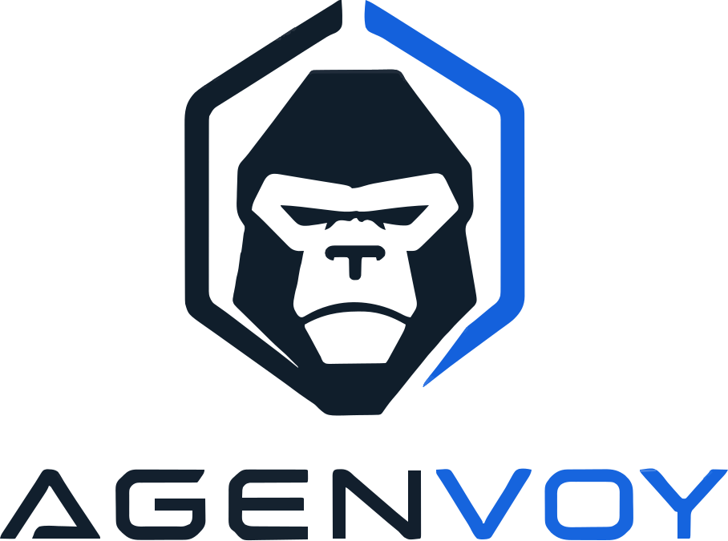

<p align="center">
  <picture style="margin-down: 1rem">
    
  </picture>
</p>

<p align="center">
  <strong>讓 AI 不只聊天，而是在你的電腦上把事做完</strong>
</p>

<p align="center">
  Agenvoy 是開源、在你自己電腦上運行的 24 小時個人 AI 代理，記憶、排程、工具與憑證都留在本機。<br>
  單一 Go 執行檔，從查資料、處理檔案到建立自動化都會實際執行；並可透過 MCP 與 Claude Code、Codex 等 Agent 共用安全沙箱工具。
</p>

<p align="center">
<a href="https://trendshift.io/repositories/41899?utm_source=trendshift-badge&amp;utm_medium=badge&amp;utm_campaign=badge-trendshift-41899" target="_blank" rel="noopener noreferrer">

</a>
</p>

<p align="center">
  <a href="https://github.com/pardnchiu/agenvoy/releases"></a>
  <a href="../LICENSE"></a>
</p>

<p align="center">
  <a href="../README.md">English</a> · <strong>繁體中文</strong>
</p>

> [!NOTE]
> Agenvoy 目前處於檢查與整理期，逐檔進度請見[優化進度](./optimization.zh.md)。

## 台灣自研 AI Agent Harness

Agenvoy 是由[邱敬幃](https://pardn.io/)開發的台灣自研 AI Agent Harness，將對話轉化為在你的電腦上實際完成的工作。它在同一套流程中協調模型、工作脈絡、工具、即時資料、任務路由、記憶、排程與執行，同時讓檔案與環境的控制權留在你手上。透過 Web 介面，Agenvoy 也支援免持語音互動，包括自然說話、喚醒詞與可打斷的語音回覆；完整結果則會保留在聊天內容中。

## 為什麼選擇 Agenvoy

聊天能給答案，工作需要成果。Agenvoy 在你的個人電腦上把請求拆成步驟、呼叫工具並交付結果；檔案、工具、排程與工作脈絡始終由你掌控。

- **把對話變成可交付的工作** — 從查即時資料、整理檔案到執行多步驟任務，Agent 會實際動手並回報結果。
- **能力不足時自己補上** — 先找免金鑰的公開 API 直接呼叫；找不到合適的，才建立、測試並保存新工具，下一次直接重用。
- **一套工具供所有 Agent 使用** — Agenvoy、Claude Code、Codex 等 Agent 可共用同一套沙箱工具庫，不必重複建立。
- **讓自動化持續運作** — 一句話建立排程，定期工作可在你的環境中執行並推送結果。
- **每一步都看得見、控得住** — 命令輸出同步顯示於 TUI 與 Web 儀表板；敏感路徑與受限操作仍須確認。
- **模型與外部服務可自由整合** — 依任務路由模型，支援圖片、STT、TTS、stdio／HTTP MCP 與 OAuth。
- **從任何地方私下存取** — Telegram 與 Discord 由本機 daemon 主動連線，不必公開主機或開放入站連接埠。

## 被驗證的設計

以下是 Agenvoy 已實作的設計方向，之後陸續也有其他團隊採用相近做法，印證這些方向能解決 Agent 在實際工作中遇到的問題。每個節點都附上公開的 commit 或發布紀錄，可自行對照。

| Agenvoy 首次推出                                                                                                                                                                                                                                                                                                                                                                                                              | 設計                       | 同方向的實作                                                                                                                                                                                                                                                                                                                                                                                                                                                                                                                                                                                                                                                                                                                                                   |
| :---------------------------------------------------------------------------------------------------------------------------------------------------------------------------------------------------------------------------------------------------------------------------------------------------------------------------------------------------------------------------------------------------------------------------- | :------------------------- | :--------------------------------------------------------------------------------------------------------------------------------------------------------------------------------------------------------------------------------------------------------------------------------------------------------------------------------------------------------------------------------------------------------------------------------------------------------------------------------------------------------------------------------------------------------------------------------------------------------------------------------------------------------------------------------------------------------------------------------------------------------- |
| 2025-06-28 [Implement core application](https://github.com/agenvoy/cim-prototype/commit/df4fa95a01)<br>2025-06-29 [add traditional memory structure](https://github.com/agenvoy/cim-prototype/commit/d9a109c270)                                                                                                                                                                                                              | 概要式記憶，實現無限上下文 | 2025-11-24 [Claude client-side compaction](https://platform.claude.com/docs/en/release-notes/overview#november-24-2025)                                                                                                                                                                                                                                                                                                                                                                                                                                                                                                                                                                                                                                    |
| 2026-01-04 [bubblewrap sandbox](https://github.com/pardnchiu/HakoRun/commit/87af1ba486)<br>2026-02-01 [harden bubblewrap sandbox](https://github.com/pardnchiu/HakoRun/commit/0cae0ed8c5)<br>2026-03-07 [block sensitive paths and credentials](https://github.com/agenvoy/Agenvoy/commit/fdaaa62b3b)<br>2026-03-18 [sandbox execution with bubblewrap](https://github.com/agenvoy/Agenvoy/commit/1f458d3596)                 | 沙盒模式，實現安全 Agent   | 2026-03-16 [NVIDIA NemoClaw](https://blogs.nvidia.com.tw/blog/nvidia-announces-nemoclaw) |
| 2026-02-07 [Copilot device code login](https://github.com/agenvoy/Agenvoy/commit/3d4020dfb2)<br>2026-04-04 [OpenAI Codex (OAuth) provider](https://github.com/agenvoy/Agenvoy/commit/748b551ce1) | 用既有 AI 訂閱直接登入 | 2026-09-29 [Pi 0.99.0 Sign in with ChatGPT](https://github.com/earendil-works/pi/blob/v0.99.0/packages/coding-agent/docs/providers.md#authenticate-interactively) |
| 2026-02-27 [LLM-driven agent routing](https://github.com/agenvoy/Agenvoy/commit/0514cc1127)<br>2026-03-10 [configurable dispatcher model selection](https://github.com/agenvoy/Agenvoy/commit/e4274818e7)<br>2026-04-15 [strengthen agent tier routing](https://github.com/agenvoy/Agenvoy/commit/055af67e44)<br>2026-06-10 [tiered routing across providers](https://github.com/agenvoy/Agenvoy/commit/d3c5d9f63a)<br>2026-09-11 [configurable model tiers for agent and subagent routing](https://github.com/agenvoy/Agenvoy/commit/2032737d23)<br>2026-09-11 [model tier controls on fallback priority](https://github.com/agenvoy/Agenvoy/commit/b393d22f12) | 依任務把工作路由到最合適的模型 | 2026-09-14 [Copilot auto model selection 三級 tier：efficiency／balance／intelligence](https://github.blog/changelog/2026-09-14-configure-cost-and-quality-in-copilot-auto-model-selection/)<br>2026-09-29 [Pi 0.99.0 virtual models: per-request model and thinking level](https://github.com/earendil-works/pi/blob/v0.99.0/packages/coding-agent/docs/virtual-models.md)<br>2026-09-29 [Pi 0.99.0 classifier models](https://github.com/earendil-works/pi/blob/v0.99.0/packages/coding-agent/docs/llama-cpp.md#classification) |
| 2026-03-23 [script tool support with sandboxed execution](https://github.com/agenvoy/Agenvoy/commit/eb789ef4be)<br>2026-05-14 [script tool scaffolding skill](https://github.com/agenvoy/Agenvoy/commit/33a62c9161)<br>2026-06-05 [script tool runtime metadata](https://github.com/agenvoy/Agenvoy/commit/74ac5bf7eb) | 沙盒工具：自訂 JS / Python 在沙盒內執行 | 2026-09-29 [Pi 0.99.0 codemode: model-written JavaScript in a QuickJS sandbox](https://github.com/earendil-works/pi/blob/v0.99.0/packages/coding-agent/docs/cli.md#enable-codemode) |
| 2026-04-02 [deferred tool loading with search_tools](https://github.com/agenvoy/Agenvoy/commit/650711b764)<br>2026-05-05 [MCP client adapter with stdio/HTTP transports](https://github.com/agenvoy/Agenvoy/commit/bda9b15a08)<br>2026-06-07 [tool search registry](https://github.com/agenvoy/Agenvoy/commit/679d5544c7)<br>2026-08-08 [MCP OAuth flow](https://github.com/agenvoy/Agenvoy/commit/751e97c541) | 工具按需載入，不全數塞進 context | 2026-09-29 [Pi 0.99.0 built-in MCP + tool_search](https://github.com/earendil-works/pi/blob/v0.99.0/packages/coding-agent/docs/mcp.md) |
| 2026-04-17 [invoke_subagent tool](https://github.com/agenvoy/Agenvoy/commit/db690a51d4)<br>2026-04-25 [session action logs](https://github.com/agenvoy/Agenvoy/commit/a78ae4e4c1)<br>2026-04-25 [session log streaming endpoint](https://github.com/agenvoy/Agenvoy/commit/78806be270)<br>2026-04-28 [subagent name dispatch](https://github.com/agenvoy/Agenvoy/commit/fb20bab34a)                                           | 呼叫子代理並追蹤其日誌     | 2026-08-03 [Claude Code 跨工作階段傳訊](https://code.claude.com/docs/zh-TW/whats-new/2026-w32)                                                                                                                                                                                                                                                                                                                                                                                                                                                                                                                                                                                                                                                             |
| 2026-05-28 [extension tool loading](https://github.com/agenvoy/Agenvoy/commit/d92d37512b)<br>2026-05-28 [extension install and upload skills](https://github.com/agenvoy/Agenvoy/commit/4566ef49ae)<br>2026-05-29 [extension marketplace](https://github.com/agenvoy/Agenvoy/commit/ddc9b02903)<br>2026-06-08 [ext_ extension tools and scaffolding](https://github.com/agenvoy/Agenvoy/commit/2f2ba6e3ae)                    | 一切皆插件                 | 2026-08-13 [DeepSeek Harness 一切皆插件](https://www.deepseek.com/harness/en/)                                                                                                                                                                                                                                                                                                                                                                                                                                                                                                                                                                                                                                                                             |
| 2026-06-03 [ask_user interruption async resume](https://github.com/agenvoy/Agenvoy/commit/137b322243)<br>2026-06-04 [preserve in-progress action memory across interruptions](https://github.com/agenvoy/Agenvoy/commit/a6b5e98f39)<br>2026-06-29 [pending task resume](https://github.com/agenvoy/Agenvoy/commit/757493e53b)<br>2026-07-03 [write_todo checklist flow](https://github.com/agenvoy/Agenvoy/commit/3b7c69cd05) | 長任務定點恢復             | 2026-08-04 [pi harness v2 in-memory storage](https://github.com/earendil-works/pi/commit/1d0c974713)<br> 2026-08-05 [pi indexed harness recovery queries](https://github.com/earendil-works/pi/commit/591f22a618)<br>2026-08-05 [pi validate harness recovery record logs](https://github.com/earendil-works/pi/commit/a5953d2e15)<br>2026-08-05 [pi harness v2 jsonl backend](https://github.com/earendil-works/pi/commit/651d5d6a53)<br>2026-08-06 [pi atomic writes + torn-tail truncation](https://github.com/earendil-works/pi/commit/a838c069e6)<br>2026-08-14 [pi AgentHarness R3 generation recovery](https://github.com/earendil-works/pi/commit/a606448360)<br>2026-08-14 [pi AgentHarness R4 tool execution](https://github.com/earendil-works/pi/commit/d411d7b05e) |

## 你可以用它做什麼

<details>
<summary><strong>問即時問題，拿到即時答案（Web Search／Tool Generate）</strong></summary>

> 台北現在天氣如何？
>
> Agent 會找即時資料、呼叫工具，再整理成答案回覆你。
>
> 如果缺工具，它會呼叫公開 API，或自己建立。

<p align="center">
  <a href="https://youtu.be/floMBsAfziY">
    
  </a>
</p>

</details>

<details>
<summary><strong>一句話變成自動化流程（Scheduler）</strong></summary>

> 每天早上 8 點回報台積電股價
>
> Agent 會確認：
>
> - 要推送到哪裡
> - 你想要什麼格式
> - 何時執行
>
> 然後自動建立排程。

<p align="center">
  <a href="https://youtu.be/5To3joKlFpU">
    
  </a>
</p>

</details>

<details>
<summary><strong>直接詢問你的本機檔案（File Search／RAG）</strong></summary>

> 找出去年所有發票
>
> 哪份文件提到 Prompt guide？
>
> Agent 會搜尋你的本機檔案並直接回答。

<p align="center">
  <a href="https://youtu.be/vqoQ6Qvl8qU">
    
  </a>
</p>

</details>

<details>
<summary><strong>完成多步驟工作（Skills／Sub-agents）</strong></summary>

> 幫我整理今天的 GitHub commits，並生成進度報告
>
> Agent 會拆解任務、呼叫工具、整合結果，再回覆給你。

<p align="center">
  <a href="https://youtu.be/nIV1xz_HIJg">
    
  </a>
</p>

</details>

<details>
<summary><strong>能跟你已經在用的 Agent 一起工作（MCP Server）</strong></summary>

> Agenvoy 也是一個 MCP server。
>
> Claude Code、Codex、OpenCode 與其他 AI Agent 連上後，可以：
>
> - 使用你所有的沙箱工具
> - 在缺工具時自動建立新工具
> - 讓所有 Agent 共用同一套工具
>
> 一行設定，即時共享工具庫。
> 影片中建立的工具：[`fetch_weather`](demo/fetch_weather/) · [`fetch_crypto_price`](demo/fetch_crypto_price/)

<table>
<tr>
<td width="33%" valign="top">

#### Claude Code 建立天氣工具 (1)

</td>
<td width="33%" valign="top">

#### Codex 重用它並建立加密貨幣工具 (2)

</td>
<td width="33%" valign="top">

#### Agenvoy 測試兩個工具 (3)

</td>
</tr>
<tr>
<td>

[](https://youtu.be/on5IaoxBO1E)

</td>
<td>

[](https://youtu.be/2DDFCIcbnso)

</td>
<td>

[](https://youtu.be/KPs4o9xDFjM)

</td>
</tr>
</table>

</details>

## 適合誰使用

如果你希望 AI 不只回覆，而是能在你掌握的環境中完成工作，Agenvoy 適合你：

- 想把研究、檔案處理、例行回報轉成可重用自動化流程的人
- 想自架 AI Agent，同時保有本機資料與沙箱安全邊界的開發者
- 想讓 Claude Code、Codex 與其他 Agent 共用工具、避免重複建置的團隊
- 需要透過 Web、Telegram 或 Discord 私下存取本機 Agent 的技術工作者

---

## 從瀏覽器操控你的 Agent

在瀏覽器管理 session、工具、排程與記憶。儀表板內建於執行檔中 — 啟動 daemon 後開啟 [http://127.0.0.1:17989](http://127.0.0.1:17989)。由你自己的機器提供服務，資料不離開你的裝置。

v1.3.4 介面改版前後的比較（old / new、淺色 / 深色）請見 [Web UI 介面差異比較](diff/README.zh.md)。

<p align="center">
  <a href="https://youtu.be/oaXxrTNvLaU">
    
  </a>
</p>

## 聊天機器人整合

目前支援 **Telegram 與 Discord**。Agenvoy 的本機 daemon 會主動連向這些平台，因此你只要設定 bot token：不必開放入站連接埠、不必架反向代理，也不必把自己的主機公開到網路上。任務執行中送出的新訊息會 steer 該任務；要另開任務請用 `/new <訊息>`（已列在 Telegram 指令選單）。

自 **v0.34.4** 起，Telegram 與 Discord 暫停「語音輸入後自動以語音回覆」的預設流程；仍可使用 STT／TTS 生成音訊，並將音訊檔傳送到頻道。

---

## 一鍵安裝

<details open>
<summary><strong>macOS／Linux 發行版</strong></summary>

在終端機執行：

```bash
curl -fsSL https://agenvoy.com/scripts/install.sh | bash
```

> **macOS 提示：**若使用 MacBook 執行排程，建議額外執行：
>
> ```bash
> sudo pmset -c sleep 0
> ```
>
> 避免電腦休眠而中斷排程。

</details>

<details>
<summary><strong>Windows（透過 WSL）</strong></summary>

請先以系統管理員身分開啟 PowerShell，查看並安裝一個 Linux 發行版：

```powershell
wsl --online --list
wsl --install <發行版名稱>
```

完成安裝、重新開機並進入 WSL 終端機後，執行：

```bash
curl -fsSL https://agenvoy.com/scripts/install.sh | bash
```

</details>

## 建議的模型設定

以下是一組容易上手、成本較低的配置：

1. 選擇一個訂閱制模型作為日常主要模型，例如：
   - GitHub Copilot（$10／月）—— 指定 `gpt-5.6-luna`，額度損耗夠慢、能力也夠日常使用
   - OpenAI ChatGPT Plus（$20／月）
   - SuperGrok（$30／月）
2. **想免費嚐鮮**，以下方式不需要訂閱：
   - **[Ollama Cloud](https://ollama.com/settings/keys)**：建立免費 API key，在 `/model add` 選擇 **Ollama Cloud** 後加入 `gemma4:31b`。免費方案有用量上限，可用 `Shift+U` 查看剩餘額度。

---

## 核心能力

| 能力         | 說明                                                     |
| :----------- | :------------------------------------------------------- |
| 自動工具生成 | 先呼叫公開 API，找不到合適的才建立並保存工具             |
| 自我排程     | 一句話建立定時任務                                       |
| 長期記憶     | 保留重要資訊與上下文                                     |
| 圖片生成     | 透過已設定的 provider 生成圖片                           |
| 即時命令輸出 | 將 `run_command` 進度串流至 TUI 與 Web 儀表板            |
| 豐富回覆顯示 | Web 對話渲染圖表、Mermaid 圖、數學公式與程式碼高亮       |
| 安全檔案邊界 | 存取敏感路徑或 `$HOME` 外路徑前要求確認                  |
| 確認說明     | 指令確認以一句話說明該次呼叫會做什麼                     |
| MCP OAuth    | 登入 HTTP MCP server，並將 token 保存至作業系統 keychain |
| 檔案搜尋     | 從本機檔案回答問題                                       |
| Sub-Agent    | 多 Agent 協作                                            |
| MCP client   | 以官方 go-sdk 連接外部 MCP 服務（工具清單即時刷新）      |
| MCP server   | 讓任何 MCP 相容 Agent 使用你的沙箱工具                   |
| 推理指引     | 透過 `reasoning_guide(topics=[...])` 按需載入規則           |
| Tool Market  | 分享與安裝工具                                           |
| 語音轉錄     | 音訊與影片轉文字                                         |
| 自我改進     | 執行失敗後自動修正                                       |

---

## 文件

完整文件請見 **[agenvoy.com/docs](https://agenvoy.com/docs/)**

- [Getting Started](https://agenvoy.com/docs/getting-started)
- [Sessions & Agents](https://agenvoy.com/docs/sessions)
- [Providers](https://agenvoy.com/docs/providers)
- [Built-in Tools](https://agenvoy.com/docs/built-in-tools)
- [MCP Server](https://agenvoy.com/docs/mcp-server)
- [MCP Client](https://agenvoy.com/docs/mcp-client)
- [Memory System](https://agenvoy.com/docs/memory-system)
- [Skill System](https://agenvoy.com/docs/skill-basics)
- [Sandbox](https://agenvoy.com/docs/sandbox)
- [Architecture](https://agenvoy.com/docs/architecture)

## License

本專案採雙授權。

- **開源授權** — [GNU Affero General Public License v3.0](../LICENSE)。可自由使用、修改與散布，但衍生作品與基於本專案提供的網路服務，須以相同授權釋出並提供原始碼。
- **商業授權** — 無法滿足 AGPL-3.0 原始碼公開義務的使用情境，可洽詢商業授權。僅涵蓋軟體本身的使用權利；任何委由開發者進行、與本專案有關的改動皆另行計價。詳見 [COMMERCIAL.zh.md](./COMMERCIAL.zh.md)。

依 AGPL-3.0 第 7(b) 條，Web 介面 `Config > System` 分頁 `Other` 區塊中的 **License** 與 **Source** 兩張卡片必須保留：它們承載著作權聲明、無擔保聲明、授權聲明，以及第 13 條要求的對應原始碼連結。可以調整位置或樣式，但須維持顯眼可及，不得移除或隱藏。取得商業授權即免除此義務。

## Author

歡迎 [開 issue](https://github.com/pardnchiu/agenvoy/issues/new) 分享想法。

<a href="https://github.com/pardnchiu/agenvoy/graphs/contributors">
  
</a>

---

©️ 2026 [邱敬幃 Pardn Chiu](https://www.linkedin.com/in/pardnchiu)
