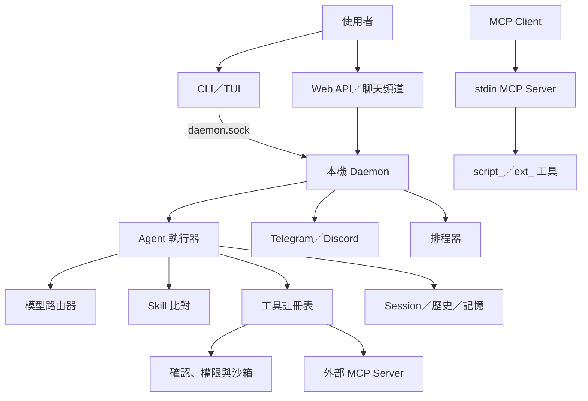
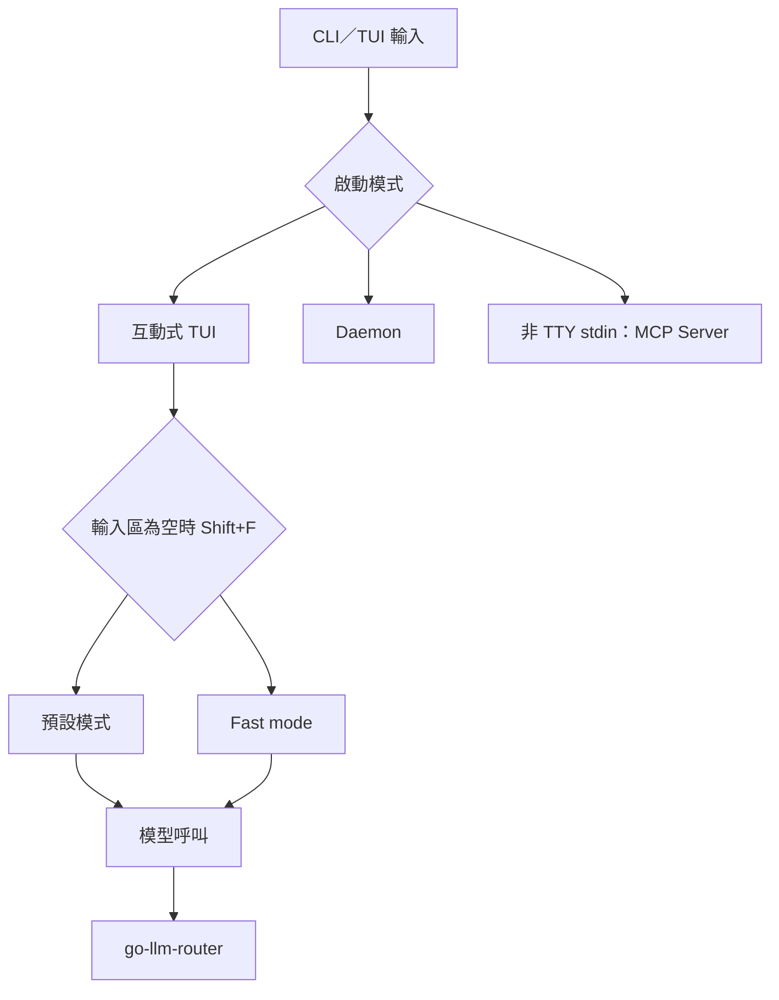
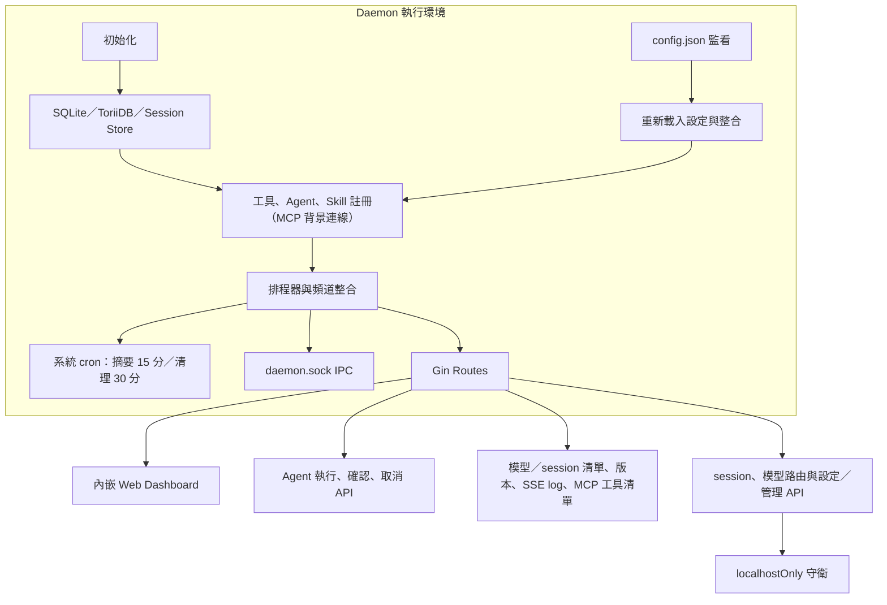
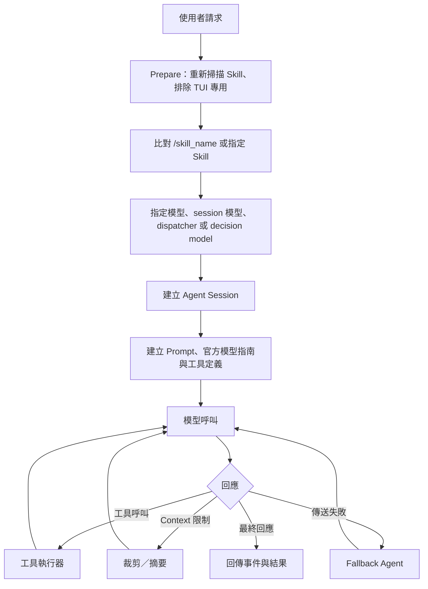
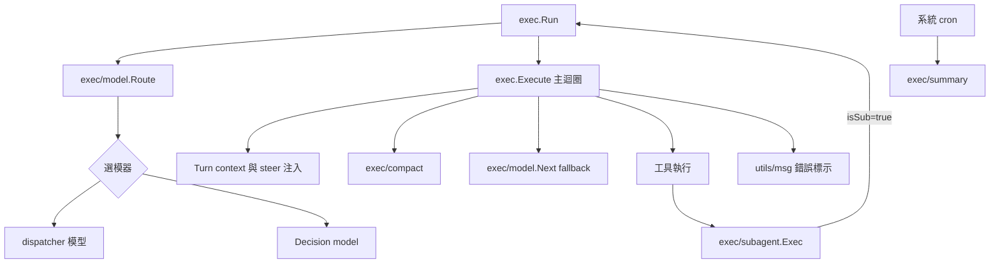
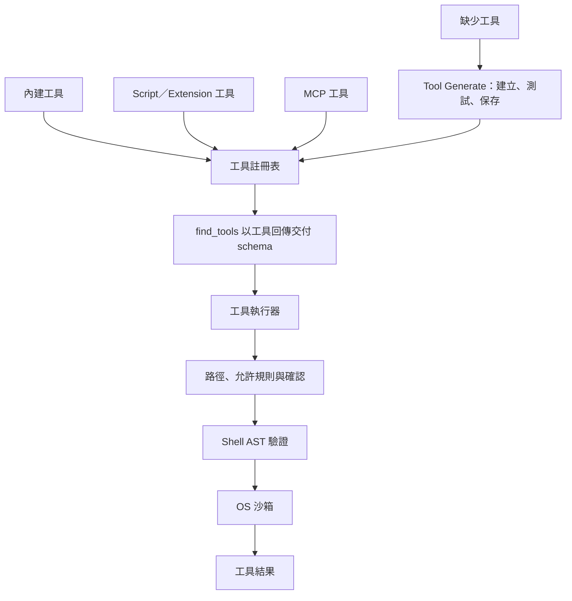
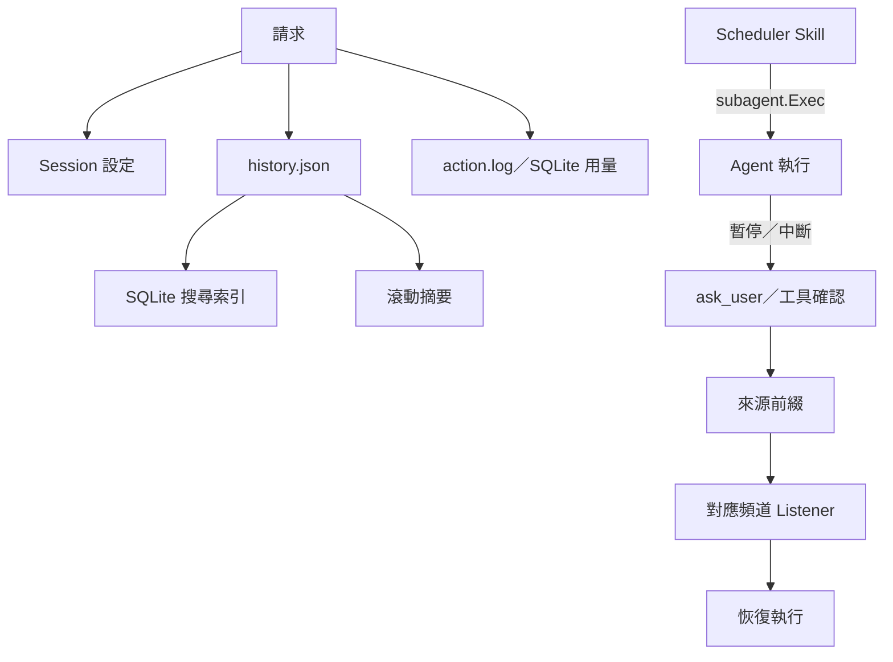
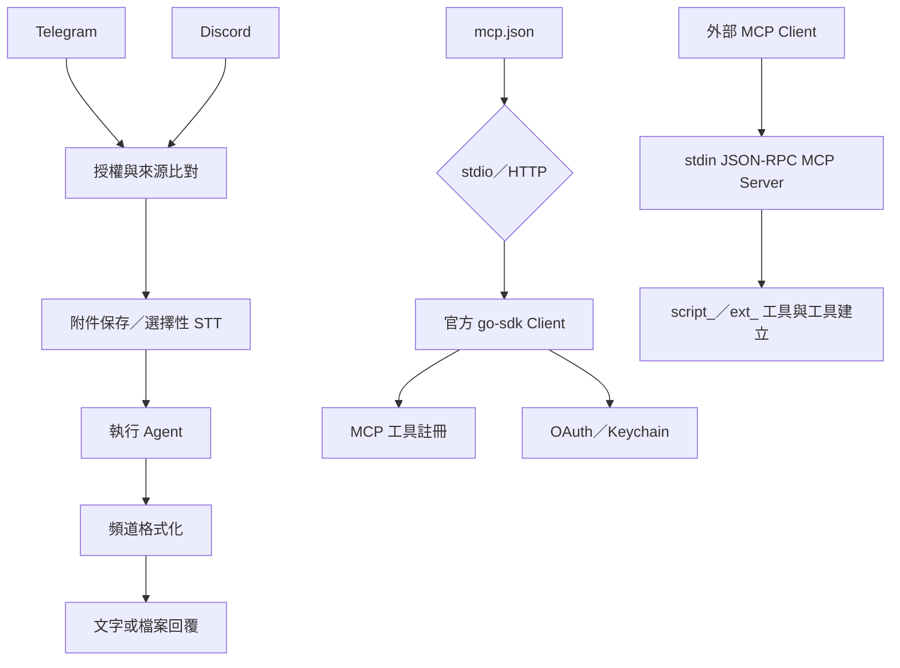
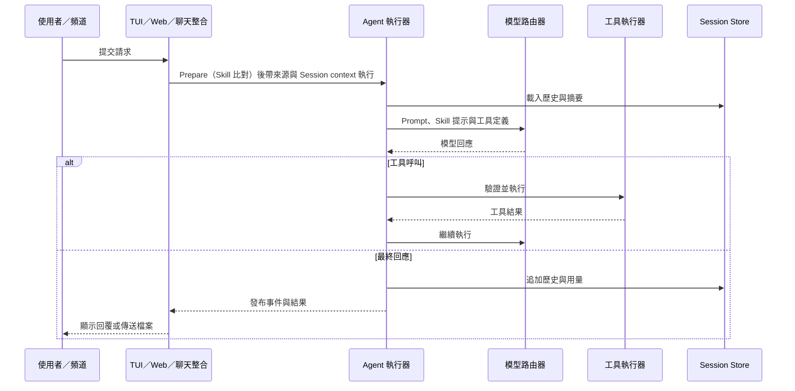
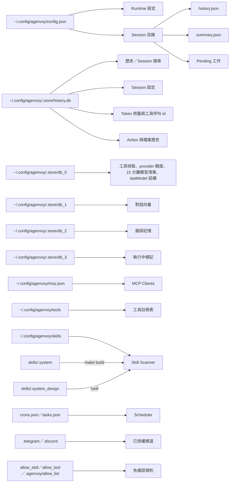

# Agenvoy - 架構

最後更新：2026-10-16

> 返回 [README](./README.zh.md)

## 概覽

Agenvoy 是以 Go 撰寫、在個人電腦上執行的本機 Agent 執行環境。它把 TUI、Web 儀表板、本機 HTTP API、Telegram／Discord 與 MCP client 整合到同一個執行引擎；stdin MCP server 是另一個較窄的介面，只提供生成與 extension 工具，不經過執行引擎。Agent 可依 Skill 與任務選擇模型、呼叫沙箱工具，並將 session、排程與歷史保留在本機。

## 模組：進入點與執行模式

`cmd/app` 預設開啟 TUI；所有 Agent 都在 daemon 執行，TUI 是它的用戶端：執行、steer、取消、確認與 `ask_user` 的回覆、`/pending` 接續，以及 `/mcp` 的狀態、重新連線與工具列表，都經 Unix socket `~/.config/agenvoy/daemon.sock`（權限 0600，newline-delimited JSON）送給 daemon，TUI 再渲染回傳的事件。TUI 發起的任務綁定該連線：關閉 TUI 即停止，可從 `/pending` 接續。連不上 daemon 時 TUI 仍可開啟，狀態列顯示 `Connecting` 並每 5 秒重連，需要 daemon 的輸入會暫停送出直到連上。TUI 啟動時若 daemon 未執行會自動以 `--daemon` 啟動它。`agen stop` 停止 daemon，`agen update` 執行官方更新器，stdin 非 TTY 時則改為 stdio JSON-RPC MCP server。`agen --enable-claude-code` 啟用 `claude-code` provider（以本機 `claude` CLI 作為模型），daemon 執行中會被拒絕，需先 `agen stop`；由它啟動的 daemon 會帶著這個設定，之後不帶參數啟動的 TUI 沿用執行中 daemon 的狀態。Web 儀表板由 daemon 提供於 `http://127.0.0.1:17989`（同時監聽 `[::1]:17989`）。

所有使用 session 的入口（TUI、Web `/send`、pending 恢復、Telegram、Discord）都經過相同的兩步進入執行：`exec.Prepare` 重新掃描 Skill、在 TUI 以外排除 TUI 專用的工具與 Skill，並解析開頭的 `/<skill_name>`；接著 `exec.Run` 查找以名稱指定的 Skill、記錄輸入、經 `exec/model.Route` 選擇模型、建立 session 並執行 Agent；subagent 與排程以 `isSub=true` 直接呼叫 `exec.Run`，不經 `Prepare`。各入口只負責自己的傳輸、授權與呈現；Telegram 與 Discord 共用同一套回覆流程（狀態訊息、分段、footer、錯誤提示與附件）。TUI 與 daemon 都會監看 `config.json`，變更時重新載入模型註冊表（daemon 另會重新連線聊天 bot）；TUI 也會訂閱 daemon log，讓 Telegram 與 Discord 的驗證碼顯示在 TUI 的 notice 框；所有 log、警告與錯誤都集中在這個框（顯示最後 4 行、保留 32 行，`Tab` 往上捲，`Esc` 清除）。

輸入區為空時可按 `Shift+F` 切換只存在於目前行程的 fast mode；執行器、dispatcher 與 summary 呼叫會把模式傳給 `go-llm-router`。Runtime 支援多個模型 provider 與 `compat` 的 OpenAI 相容端點，並可獨立設定 dispatcher、summary、圖片生成、STT 與 TTS；已註冊模型的順序可自訂，選中的模型失敗或串流無回應時，依此順序往下找（略過 `pass` tier 與失敗模型同 provider 的模型），每個候選先做 10 秒健康檢查，最多 4 輪；session 固定模型時不 fallback。每個模型可在 `model_tag` 設定 tier（`S` `A` `B` `C` `pass`），未設定時依模型名稱推斷（例如 opus→S、haiku→B、`-mini`→C），無法辨識的才預設為 A；dispatcher 依工作類型排序 tier；已設定 decision model（`decision_model`，TypeSafe 或 OpenRouter 的 decision model）時，decision model 與 dispatcher 模型同時執行，先取得有效回答者勝出：它把請求分為 `code`、`chat`、`fetch`、`research`、`work` 並判斷是否點名模型、是否延續上一則請求（延續時沿用 session 前一個模型與 reasoning 以重用快取；前一個模型記在 ToriiDB db_0 的 `lastModel:<session>`，依 provider 保留 5／30／60 分鐘），再由程式依該類型的 tier 順序排序（`research` 先 S、`work` 先 A），呼叫失敗或 3 秒內沒回應時採用 dispatcher 模型的回答；selector 回的工作類型同時決定 reasoning 等級（`xhigh`、`none`、`low`、`high`、`medium`），僅在 session reasoning 設為 `auto` 時採用（固定模型的 session 也適用），請求自帶的等級仍優先；同一 tier 內先排訂閱制的 `claude-code`、其次 `codex`；同一模型註冊在多個 provider 時，最後由 `config.OrderByRank` 依 `claude-code`、`codex`／`grok-oauth`、`copilot`、直接 API、`openrouter` 重排（點名或延續的模型維持在最前）；標記為長 context 的工作類型（目前是 `research`）反轉其中一段，同 tier 內把 `copilot` 排到最後，因為同一個模型經該 provider 轉售的 context window 較小。每條 subagent leg 都必須指定 `model`，可另帶 `reasoning`（預設 `auto`）。傳入具名模型時直接使用，會覆蓋 `self_id` session 自己固定的模型；傳 `auto` 時改用該 session 固定的模型，session 也是 `auto` 才走一般 dispatcher。reasoning 為 `auto` 時沿用 session 設定，仍為 `auto` 則由選模器決定。`reasoning_guide` 的 `subagent_dispatch` 主題會把各工作類型的 tier 順序整體降一階（例如 `code` 為 A > B > C > S、`work` 為 B > A > C > S）提供給父模型參考，程式本身不強制。本機 OpenAI 相容端點以 `<name>@<model>` 註冊；自訂端點網址記錄在 `config.json` 的 `compats`，`/model add` 在預設 port 偵測到的 Ollama 與 llama.cpp 則為內建端點。免費試用 Agenvoy 建議使用 `ollama-cloud` 的 `gemma4:31b`（免費 API key，有用量上限），它不是必要的 dispatcher 或主要模型。

## 模組：Daemon、Web 與 HTTP API

Daemon 依序載入 runtime 設定、初始化 ToriiDB、清除過期的執行中標記、開啟 SQLite 歷史資料庫與用量表；接著註冊圖片／音訊／聊天工具、同步 Web 資源、檢查沙箱、註冊 subagent 與 Skill scanner，MCP 在背景非同步連線；再啟動排程器與兩個系統 cron（每 15 分鐘產生摘要、每 30 分鐘清理 session）、config 與 session 監看及 Telegram／Discord；最後依序註冊 Web 確認 listener、開啟 IPC socket 與 HTTP API。Dashboard 嵌入二進位檔後由 `/` 提供，開發時可用 `AGENVOY_PAGE_DIR` 改讀磁碟。HTTP API 只監聽 `127.0.0.1` 與 `[::1]`；另外，`localhostOnly()` 保護 session 管理、模型路由／tier／優先序、provider 與憑證、MCP 設定、角色（`/v1/role`，`/v1/rule` 為舊別名）、Skill、排程、白名單、runtime 設定、檔案、用量、頻道、語音、錯誤記憶、daemon log 與系統更新。Agent 執行（`/v1/send`、`/v1/chat/completions`）、確認、取消、pending 工作、session 清單、模型清單（`/v1/models`）、版本、SSE log、`/v1/mcp/tools` 與 Dashboard 靜態資源則不加守衛。

## 模組：Agent 執行、Skill 與模型路由

每個請求先檢查 Skill；開頭的 `/<skill_name>` 是唯一的行內語法，委派給特定 session 則透過 `subagents` 工具帶 `self_id`。Skill 描述會作為模型選擇提示。呼叫端明確指定的模型（例如 `/send` 的 `model` 欄位）會直接使用，未註冊時回傳錯誤；未指定時由 session 綁定的模型或 dispatcher 決定。完成事件帶有實際使用的 reasoning 等級，以 `model/reasoning` 顯示，並以 `reasoning=` 記錄在 `action.log` 的 `done` 行。事件不帶 provider 額度：TUI 與 Web 聊天在收到事件後，另外非同步查詢回答所用模型的剩餘額度，不阻塞事件（`claude-code`（讀 `claude -p /usage`，不打 API）、`codex`、`grok-oauth`、`copilot`、`ollama-cloud` 為百分比，`openrouter`、`deepseek` 為餘額）。TUI 顯示在狀態列右側，Web 聊天顯示為回覆上的標籤；Telegram 與 Discord 的 footer 不顯示額度。執行器建立帶有來源、附件與 session context 的 prompt，依序加入 `official_guides/` 的三層：`_base.md`（一律注入）、模型名含該廠商字樣時的 `_vendor_<vendor>.md`（例如自 Anthropic 總表萃取的 `_vendor_claude.md`）、檔名被模型名包含的那份模型指引（最長 key 優先）；模型檔與 vendor 檔都沒命中時，後兩層改注入 `_base_unlisted.md`。`claude` 開頭的 key 比對時把 `.` 與 `-` 互換後再比，所以 `claude-opus-5.5.md` 同時吃 `claude-opus-5.5` 與 Anthropic 官方的 `claude-opus-5-5`。三層是合併而非串接：同名的 `## 區塊` 只出現一次，後面層的條目接在同一個標題下，逐字相同的條目去重，選定主要 Agent 後迭代執行模型回應與工具呼叫。歷史達模型輸入上限的 80% 時會 compact；上限值取自 `llm-io.agenvoy.com`，執行前最多每小時刷新一次，依 vendor 與模型查找（`nvidia`、`openrouter` 模型以模型名稱內的 vendor 解析），`copilot@` 模型另會非同步向 GitHub Copilot models API 暖機模型限制快取，最多每 24 小時刷新一次；若 API 回報 chat 模型的 `max_context_window_tokens`，就使用該值。未知 Copilot 模型退回一般 128K 上限，其他未列模型也使用 128K。TUI 會以解析出的輸入上限顯示目前 context token 用量，並在達上限 80% 時開始 compact。模型傳送失敗時會使用 fallback Agent。圖片生成、STT 與 TTS 是可各自設定的模型路由能力。

Skill 依固定順序掃描，同名時先找到的生效：`<cwd>/.skills`、`<cwd>/.claude/skills`、`~/.config/agenvoy/skills/.system`、`~/.config/agenvoy/skills/.system_design`、`~/.config/agenvoy/skills`，最後是 `~/.claude`、`~/.codex`、`~/.opencode`、`~/.copilot`、`~/.agents` 的 skills；`config.json` 的 `skill_source_off` 可停用個別來源。掃描目錄內其他以 `.` 開頭的資料夾會被略過。`.system` 每次 `make build` 都會以 `extensions/skills` 重建；`.system_design` 存放 TUI `/skill` 指令管理的官方 Skill，勾選時從 `github.com/agenvoy/skill-<name>` clone、取消勾選時刪除，因此重建不會清掉它們。兩個資料夾中的 Skill 來源都標為 `system`，Web 介面無法刪除。

Skill 以 `/<name>` 啟動時，歷史中補一組假的 `run_skill` 呼叫，執行規則與解析後的 SKILL.md 放在它的 tool result。system prompt 有無 Skill 都相同，Skill 與一般對話切換時 prompt cache 不會中斷。tool 歷史在 compact 或換模型時會被清空，Skill 內容隨之移除，後續步驟由 todo 清單承接。

## 模組：執行器子套件

`internal/agents/exec` 依職責拆成多個子套件，主迴圈只負責組 prompt、送模型與分派工具：

- **`exec/model`**：`Route` 決定指定模型、session 模型或選模器（`selectWithLLM`／`selectWithDecision`，開啟 decision dispatcher 時兩者同時執行），並建立 fallback 清單；`Next` 在失敗時挑下一個候選並以 `CheckAlive` 做健康檢查（compat 端點打 `/models`，其他 provider 走 probe 或 health endpoint）。
- **`exec/subagent`**：`Exec` 建立或接回子 session（`temp-` session 不讀歷史）、繼承父層工作目錄、allow-all 與 `DeliverTo`，排除寫檔與有持久副作用的工具後以 `exec.Run(..., isSub=true)` 執行，最多 3 條並行；遇到提問時由 `waitResume` 等待回答。
- **`exec/chatbot`**：新對話的驗證碼除了寫入 daemon log，也會轉發到 `config.json` 設定的 admin 對話（`tg@<id>`／`dc@<id>`，須已授權）。
- **`exec/summary` 與 `exec.Reset`**：daemon 每 15 分鐘產生滾動摘要，優先用 summary 模型，冷卻中或內容過大時退回主模型；有 decision model 時，合併前先移除雜訊對話與過時的 `key_decisions`／`past_discussions`；`Reset(withSummary)` 先重建摘要，產生不了就中止以免遺失 context。
- **`exec/compact`**：非第一輪且上一輪 input tokens 達上限 80% 時，先萃取舊歷史再壓縮工具歷史；context 超長錯誤走 `TrimRatio`：先由 decision model 移除請求已不需要的工具步驟（保留最新一步與 `write_todo`），再以 `TrimFallback` 依最舊優先刪減；換模型時先試 `RawToolFallback`，不行才清空工具歷史。
- **Turn context 與 steer**：工作目錄、權限模式、`run_tool` 工具名單、Skill 清單與 `CLAUDE.md`／`AGENTS.md`（開啟 guide 時）每輪以一則 user 訊息注入在使用者輸入之前（模板位於 `configs/prompts/system_prompt/inject/`），system prompt 因此保持穩定；有 decision model 時，Skill 清單只保留與請求相關的 Skill，現有工具都不涵蓋請求時另加一行提示查閱建工具指南；執行中送入的 steer 經 IPC 進入佇列，下一輪以 `inject/steer.md` 注入，session reset 時清除。
- **`agents/decision`**：`Ready` 與 `Request` 取得已設定的 decision model 並整理請求文字，`Decide` 以 3 秒逾時呼叫一次，`Batch` 依字數與題數切分大量輸入，`Confident` 在信心值達 0.7 時採用回答；未設定 decision model 或呼叫失敗時，各呼叫端維持原本的行為。
- **`/v1/chat/completions`**：不經 `Prepare`／`Run`，以 stateless session 直接呼叫 `exec.Execute`，預設排除所有工具，agent 模式 header 才開放。
- **錯誤訊息**：錯誤一律經 `internal/utils/msg` 的 `New`／`Wrap`／`Trace` 建立，格式為 `[Label] target: reason`；標示限 `Invalid`、`Not found`、`Denied`、`Conflict`、`Limit`、`Unavailable`、`Timeout`、`Upstream`、`Canceled`、`Internal`，包裝層保留最底層的標示，讓 agent 與 log 能直接判斷類別。

## 模組：工具註冊表與沙箱

內建工具、script／extension 工具及外部 MCP 工具都進入同一份註冊表。所有工具依名稱排序；tool payload 只帶 `find_tools`、`run_tool`、`reasoning_guide` 的完整 schema，其餘工具以名稱列在每輪注入的 TurnContext，schema 由 `find_tools(mode=search)` 以工具回傳內容交付、不寫回 tool payload，呼叫則經 `run_tool(name, args)`，因此整個 session 的工具序列化結果逐位元組不變，prompt 快取得以保留。`claude-code` provider 不帶 `run_tool`，僅收到工具名稱與完整 `find_tools` schema，取得 schema 後直接以名稱呼叫。執行前，工具執行器會檢查 denied path、敏感路徑、命令政策、確認需求、參數驗證、`run_command` 的 shell AST validation 及作業系統沙箱。指令一律在禁網下執行，需要連線的呼叫帶 `network: true`，帶了就跳確認且不比對唯讀白名單；argv `['sudo', ...]` 與 `sandbox: false` 經系統密碼確認後在沙箱外執行，`rm` 改為移至垃圾桶。工具確認依序判斷：讀取敏感路徑一律確認、本輪全部允許則略過、破壞性 mode 一律確認、`open_file` 開 URL 一律確認、唯讀工具與唯讀指令略過，最後比對使用者的 allow-list（全域 `~/.config/agenvoy/allow_tool` 與專案 `<workDir>/.agenvoy/allow_list`，條目可寫 `name` 或 `name(argGlob)`）。一般工具確認會詢問是否允許該次工具呼叫；受限路徑、`sudo` 指令與 `sandbox: false` 指令在支援的頻道還需要系統驗證，任何權限模式都一樣。`run_command` 與 `background_command` 的確認附一句由 dispatcher model 以單次、不帶 session 歷史的呼叫產生的說明；唯讀的 `run_command` 免確認且並行執行。拒絕時有三種退出：跳過該次呼叫（可附理由給 agent）、中止任務並保留 pending，或取消任務並刪除 pending。命中 denied path 或使用者設定的 denied command 會直接拒絕；不在 denied command 清單不代表失敗，但仍可能進入一般確認流程。

檔案工具透過共用的邊界檢查解析路徑。`find_files` 支援列出目錄、檔名 glob 與 regex 內容搜尋。glob 結果依修改時間由新到舊排列。search 採分頁：`output=files` 回傳每個符合的路徑、命中次數與前 5 個命中行號，查詢夠精準時可直接接 `read_files`；`output=content` 回傳符合的行，可加 `context` 前後文；`multiline` 讓 regex 對整份檔案比對，`.` 可跨行，`^` 與 `$` 仍為行錨點。序列化結果上限為 128 KiB。`read_files` 批次處理文字與支援的文件、圖片、音訊／影片格式，文字預設每次讀 2048 行。純文字檔可用 `around` 讀取指定行號前後各 `context` 行（預設 20），重疊的窗口會合併，略過的內容以一行 `...` 標示；同一路徑可在一次呼叫中出現多次，結果依序串接。`edit_file` 提供 write、patch、remove、restore 四種模式。寫入或修改既有檔案時，`read_files` 必須已在同一次執行中記錄過它的修改時間，且磁碟上的修改時間之後未變；寫入成功會更新這個記錄，因此連續 patch 不需重讀。patch 的 anchor 無法精確比對時，會把彎引號視為直引號再比對一次，替換內容也會沿用檔案原本的彎引號樣式。檔案變更在可用時記錄於 SQLite 歷史；歷史記錄失敗不會撤銷已完成的寫入，並會回報給呼叫端。長篇成果（Markdown 或 HTML）經 `write_result` 寫入設定的輸出資料夾；HTML 寫入前會先驗證 QuickUI 掛載、inline script 語法與模板綁定，不符即不寫入並回傳問題清單（`output_dir`；預設 `~/Downloads`，不存在時為 `~/.config/agenvoy/download`），不寫入工作目錄，其他替使用者產生的檔案在請求沒指定位置時也放在這裡。`run_command` 會等待程序結束，因此會啟動 file watcher 的命令（`--watch`、`chokidar`，或會啟動 watcher 的 package script，含經 `sh -c` 與 `package.json` 展開者）在執行前即拒絕；這類命令與長時間工作改由 `background_command` 執行，它立即回傳 task id，結束時帶著輸出接續任務。它一律監看輸出：輸出行命中錯誤關鍵字（`keywords`，內建預設清單）時，會在指令繼續執行的同時帶著最新輸出接續任務；有 decision model 時，誤判與重複上次回報的會先被濾掉。執行期間的輸出寫在 `sessions/<id>/background/<task>.log`，指令結束後刪除。耗時的 subagent 以同樣方式走 `background_subagents`；兩個工具只提供給 TUI 請求。有 decision model 時，`search_web` 剔除與請求無關的結果，`fetch_page` 在存快取前去除頁面雜訊，與請求無關的頁面不交給模型。缺少即時資料工具時，Agent 先以 `public_api_list` 找免金鑰的公開 API 並用 `http_request` 呼叫；只有找不到合適的 API，或使用者提供的 API 需要金鑰時，才建立、測試並保留 script 工具。Web Search 與檔案搜尋可直接提供即時或本機資料；RAG 沒有內建工具，需由外部 MCP server 提供。

## 模組：Session、歷史與排程

Session ID 前綴代表來源：`cli-`、`chat-`、`tg-`、`dc-` 與 `temp-`。Session 設定、token 用量（`claude` 與 `claude-code` 的 input 含 cache 寫入量，與其他 provider 回報「未命中 cache 的 input」一致）、action history 與檔案歷史存於 SQLite（`history.db`）；訊息、摘要、`action.log` 與 pending 工作依 session 目錄保存。執行中的工作會在 ToriiDB 寫入短效 `action:<session>:<task>` 標記並定期刷新，因此 pending 清單只會顯示可恢復的工作。工具確認與 `ask_user` 提問依 `Origin` 導向對應 listener，`DeliverTo` 決定哪個 session 視窗接收提問與結果；TUI 連線只接自己發起的任務的提問（以任務帶的 window hash 比對），多個 TUI 同時開著也不會收到彼此的提問；其他來源的任務（例如跑在 `cli-` session 的排程）沒有 listener，走逾時轉 pending 的路徑；subagent 在自己的 session 執行，但繼承父層的 `Origin`，並透過 `DeliverTo` 把提問送回父層 session。TUI 發出的 `ask_user` 為 inline 提問，執行不中斷；其他來源則中止執行並寫入 pending（其中 tool args 截 4 KiB、result 截 32 KiB，保留前 3/4 與後 1/4），由之後的回答續跑。工作會先註冊再競爭每個 session 的併發名額，因此排隊中的工作仍可見、可取消。使用者取消（TUI 取消或 `ctrl+c`、**Abort task**、cancel API）會移除該任務的 pending；暫停與其他中斷只停止執行，pending 保留可恢復。排程器以 subagent 路徑執行週期或單次的 scheduler skill（不經 `Prepare`，套用 subagent 的工具限制與 30 分鐘逾時）。

## 模組：聊天頻道與 MCP 整合

Dashboard 的 System 分頁會比對目前版本與 GitHub 最新 release，並可開啟終端機執行 `agen update`（macOS 為 Terminal.app，WSL 經 `cmd.exe` 進入 distro，Linux 為終端機模擬器）。Telegram 與 Discord 由本機 daemon 主動連線，因此不需開放入站連接埠或公開主機；設定只需要對應 bot token。兩個頻道都支援附件保存與選擇性 STT 轉錄、依來源配對的確認、格式化回覆及音訊檔傳送。自 **v0.34.4** 起，暫停「收到語音輸入後自動產生並回傳語音輸出」的預設流程；本機仍可使用 STT／TTS 生成音訊並將檔案傳送到頻道。

外部 MCP server 可經 stdio 或 streamable HTTP 連接；工具清單變更時會重新註冊工具，server instructions 會加入 Agent system prompt。HTTP MCP server 可走 OAuth，token 與 client id 會存於 keychain。Agenvoy 本身也能以 stdin JSON-RPC MCP server 服務 Claude Code、Codex、OpenCode 與其他 MCP Client；它不共用 Agent 的工具註冊表，也不執行 Agent，只提供 `script_*`、`ext_*` 工具，加上 `tool_generate_guide`、`public_api_list`、`list_tools`、`edit_tool`、`test_tool` 與 `store_secret`，讓 client 能找公開 API，或建立並呼叫生成的工具。

## 資料流

## 安全邊界

- Daemon 只監聽 `127.0.0.1` 與 `[::1]`；管理類 endpoint 另有 `localhostOnly()` 守衛。
- denied path 與 denied command 會直接拒絕；敏感路徑、檔案工具在 `$HOME` 外的讀取與寫入（`read_files`、`find_files`、`file_history`、`edit_file`、`open_file`）及其他受限操作則要求明確確認，支援時再要求系統驗證；核准範圍限於該 session 與所請求的路徑或執行檔。
- 透過 `edit_file` 寫入或修改既有檔案前，必須在同一次執行中成功以 `read_files` 讀過該檔，且之後修改時間未變，否則拒絕；新檔案不需事先讀取。這項新鮮度檢查是路徑邊界與權限檢查的補充，不取代它們。
- 命令執行受 shell AST validation 及 OS 沙箱限制（macOS 的 `sandbox-exec`、Linux 的 `bwrap`），且預設禁網；該次呼叫帶 `network: true` 才開放，且要求確認。需要寫入 `$HOME` 以外的命令，要在該次呼叫以 `write_paths` 宣告路徑；需要 root 的命令以 argv `['sudo', ...]` 執行（不接受 sudo 參數，也不可放在 `sh -c` 內），以 `sudo -n` 在沙箱外執行；兩者都由使用者輸入系統密碼核准。被沙箱擋住且找不到可放行的路徑時，回傳內容會提示改用 `sandbox: false` 重跑。script 工具的沙箱保持網路開啟，只能寫入 `$HOME`。
- 憑證與 provider、MCP 的 OAuth token 存在作業系統 keychain（macOS Keychain、Linux `secret-tool`），不寫入 repository；`secret-tool` 失敗時改存 `~/.config/agenvoy/.secrets`（權限 0600）；都查無時最後才讀同名環境變數。

## 持久化結構

---

©️ 2026 [邱敬幃 Pardn Chiu](https://www.linkedin.com/in/pardnchiu)